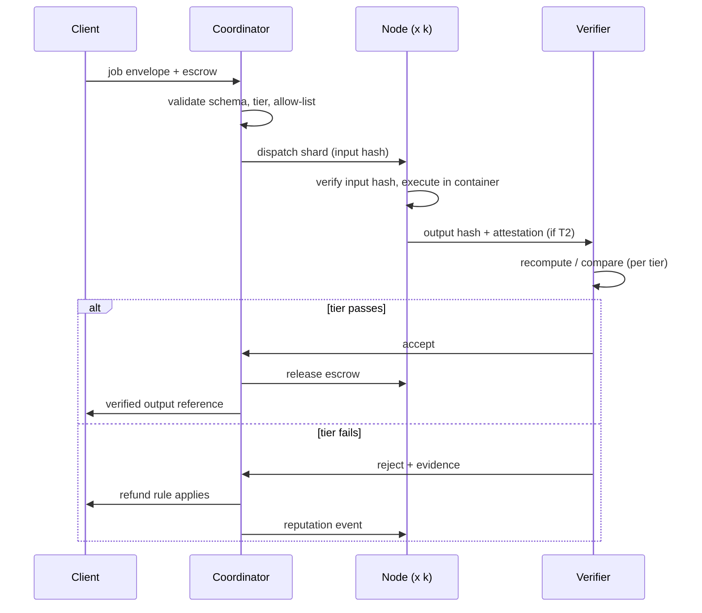

# PR-005 · A Protocol for Verified Decentralized Services

| Field | Value |
|---|---|
| **ID** | PR-005 |
| **Status** | Draft |
| **Author(s)** | anonymous contributor |
| **Created** | 2026-10-25 |
| **Last updated** | 2026-10-25 |
| **Comment period** | 14 days from first publication |
| **Related** | [`RES-007`](../research/decentralized-compute.md) · `OQ-007`, `OQ-017`, `OQ-018`, `OQ-026` |

> **Official status:** none. This document is a community proposal and has not been submitted to, reviewed by,
> or endorsed by Pi Network or the Pi Core Team. It does **not** describe the behaviour of any existing
> coordinator. It is not an offer of compensation and makes no statement about earnings.

---

## 1. Summary

A job protocol for running work on Pi Nodes through SoloHost-style apps, where **the verification method is a
declared property of the job** rather than an assumption.

The protocol's purpose is to make one specific sentence safe to say: *"this result was produced by a stranger's
computer, and here is why you can rely on it."* If that sentence cannot be completed, the job should not run.

---

## 2. Problem

| Who is harmed | How | How you would notice |
|---|---|---|
| Clients | Cannot tell a correct result from a plausible one | Paying for silent corruption |
| Node operators | Cannot price risk or know when they will be paid | Working without terms |
| The network | An unverified compute story invites abuse and fraud | Incidents that discredit the whole effort |
| Data subjects | Confidential inputs may route to untrusted machines | A breach with no contractual basis |

`FACT` — Pi completed an initial distributed-computing test through a SoloHost app with five volunteer Nodes,
covering "connecting to a Pi coordinator, receiving and processing computing jobs, and reporting results back",
with participating Nodes to be compensated by third-party clients in Pi (`S-29`).

`ANALYSIS` — The official description covers **plumbing**, not **correctness**. Five honest volunteers
completing tasks does not demonstrate that a dishonest node would be caught — and a marketplace is defined by
what happens when someone cheats, not by the demo.

---

## 3. Motivation

`ANALYSIS` — The interesting asset is not 420,000 machines; it is that the capital cost is already sunk
(`S-31`). That makes marginal compute cheap, and it makes the *verification premium* the dominant cost. A
protocol that pretends verification is free will produce either fraud or unaffordable jobs. A protocol that
prices verification explicitly can serve both cheap, unimportant work and expensive, important work.

---

## 4. Specification

### 4.1 Job envelope

| ID | Level | Requirement |
|---|---|---|
| CS-1 | MUST | Every job is described by a `pi-compute-job/1` envelope, content-addressed |
| CS-2 | MUST | The envelope declares `verification_tier` from the closed set in §4.2 |
| CS-3 | MUST | Inputs are referenced by content hash; the hash MUST be checked before execution |
| CS-4 | MUST | Outputs are content-addressed; a result without a hash is invalid |
| CS-5 | MUST | The envelope declares `privacy: {confidential: bool, retention: enum}` |
| CS-6 | MUST | A confidential job MUST NOT be assigned a tier below T2 |
| CS-7 | MUST | The envelope declares deadlines, resource bounds, and maximum retries |
| CS-8 | MUST | Payment terms are fixed in the envelope before assignment; no post-hoc pricing |

### 4.2 Verification tiers

| Tier | Method | Trust assumption | Cost multiple | Permitted use |
|---|---|---|---|---|
| **T0** | Self-report | Trust the node | 1× | Non-critical, client's own nodes |
| **T1** | Independent recomputation by *k* nodes; agreement required | ≥ 1 honest in *k* | *k*× | Default for batch work |
| **T2** | Hardware attestation | Vendor + attestation chain | 1× + overhead | Confidential jobs |
| **T3** | Cryptographic proof | The proof system | 10×–10,000× | High-value, small outputs |
| **T4** | Optimistic challenge window with stake | Economic (stake > cheating gain) | 1× + insurance | Deferred-consumption jobs |

| ID | Level | Requirement |
|---|---|---|
| CS-10 | MUST | T1 uses *k* ≥ 2 independent operators; *k* ≥ 3 SHOULD be the default |
| CS-11 | MUST | Under T1, disagreement is resolved by further recomputation, not by majority alone, when *k* = 2 |
| CS-12 | MUST | A node's operator identity is distinct from its machine identity, for independence checks |
| CS-13 | MUST | T4 challenge windows are ≥ 24 hours and recorded on-chain or in an append-only log |
| CS-14 | MUST NOT | A T0 result be presented as verified |

### 4.3 Assignment and scheduling

| ID | Level | Requirement |
|---|---|---|
| CS-20 | MUST | Assignment is deterministic given the job envelope and a published seed, so it can be audited |
| CS-21 | MUST | A node declares capabilities; a job MUST NOT be assigned beyond them |
| CS-22 | MUST | Duplicate assignment (same job to the same operator) is rejected |
| CS-23 | SHOULD | Assignment prefers under-used nodes to reduce concentration |

### 4.4 Settlement

| ID | Level | Requirement |
|---|---|---|
| CS-30 | MUST | Payment is escrowed before a job is dispatched |
| CS-31 | MUST | Release occurs only when the declared tier passes |
| CS-32 | MUST | Partial work under T1 (a minority result) is compensated only if the envelope says so |
| CS-33 | MUST | Refunds follow a published rule (deadline missed, verification failed, client cancelled) |
| CS-34 | MUST NOT | A client withhold payment for a valid result without a recorded dispute |
| CS-35 | SHOULD | Settlement references a ledger transaction, not only an internal balance |

### 4.5 Reputation and disputes

| ID | Level | Requirement |
|---|---|---|
| CS-40 | MUST | Reputation is derived only from verified outcomes |
| CS-41 | MUST NOT | Reputation be purchasable, transferable, or self-declared |
| CS-42 | MUST | A dispute states the claim, the evidence hash, and the requested remedy |
| CS-43 | MUST | Dispute outcomes are published, including the losing side's position |
| CS-44 | SHOULD | Persistent fraud results in exclusion from T1/T4 eligibility, not merely a lower score |

### 4.6 Abuse

| ID | Level | Requirement |
|---|---|---|
| CS-50 | MUST | Job classes are declared in the envelope from a published allow-list |
| CS-51 | MUST | Clients are accountable: a deposit or reputation stake is required to publish |
| CS-52 | MUST | A reporting path exists for illegal or harmful jobs |
| CS-53 | MUST NOT | A node operator be responsible for policing job content; the protocol places accountability on the client |

`ANALYSIS` — CS-53 is a deliberate allocation of liability. Making a homeowner responsible for the legality of
arbitrary work executed on their machine would make participation irrational and unenforceable.

---

## 5. Non-goals

| Not solved | Why |
|---|---|
| Low-latency serving | Consumer nodes and residential networks are unsuitable |
| Large-model distributed training | Interconnect-bound; a datacentre problem |
| Guaranteeing earnings | Price- and utilisation-dependent; out of scope |
| Anonymous compute | Conflicts with accountability (CS-51) |
| Confidential computing on all hardware | T2 requires specific hardware; T0/T1 remain the default |
| Replacing Pi's consensus or node roles | Orthogonal; see §7 |

---

## 6. Rationale

| Decision | Reason |
|---|---|
| Verification tier per job | A single tier is either unaffordable or unsafe |
| T1 as default | Only cheap method both understandable and effective |
| Confidential jobs pinned to T2 | Data protection cannot be a preference |
| Deterministic assignment | Auditability; prevents quiet favouritism |
| Escrow before dispatch | Protects the party with less information (the node) |
| Reputation from verified outcomes only | Sybil resistance |

---

## 7. Security considerations

| If a participant is malicious… | Then… | Control |
|---|---|---|
| A node returns wrong results | Corruption, silent | T1 recomputation; CS-10 |
| Many Sybil nodes agree on a lie | Majority captured | Operator independence (CS-12); stake; *k* selection audit |
| A node exfiltrates input data | Breach | T2 for confidential jobs; container isolation |
| A client publishes illegal work | Legal exposure | Allow-list, accountability (CS-50/51), reporting |
| A client refuses to pay | Node works for free | Escrow (CS-30), dispute (CS-42) |
| A malicious SoloHost app compromises the host | User machine compromised | Official guidance: assess packages, install at own risk (`S-31`) |
| A coordinator censors or favours nodes | Unfair access | Deterministic assignment (CS-20); published seed |
| A node claims hardware it does not have | Verification failure under T2 | Attestation; capability spot-checks |

> **Not a validator.** Running a Pi Node does not by itself confer consensus authority
> ([`SOURCES.md`](../SOURCES.md) §5). Nothing in this protocol should be read as a claim about chain validation.

---

## 8. Architecture and reference implementation

Four roles, and the tier decides which of them must be independent:

| Role | Does | Trusted for |
|---|---|---|
| **Client** | Publishes the job and funds escrow | Nothing — it may lie about the result it received |
| **Coordinator** | Validates, shards, dispatches, settles | Correct dispatch and payment; not correctness of output |
| **Node** | Executes in a container, returns an output hash | Its own attestation only, unless the tier requires verification |
| **Verifier** | Recomputes or compares per tier | The acceptance decision |

The tier (`T0`–`T4`) is the only knob that changes the trust graph; see §4 for what each tier guarantees and
what it explicitly does not.



```text
acceptance test:
  spawn k=3 simulated nodes; make one emit a corrupted output
  assert the job is NOT accepted under T1
  assert the honest nodes are paid and the corrupt one is not
  assert the same corruption is NOT detected under T0 (documenting the risk)
```

The last assertion is as important as the first: a test suite that only demonstrates success does not
demonstrate the tier boundary.

---

## 9. Backwards compatibility

New protocol; the existing five-node PoC is not a compatibility target. If an official coordinator API emerges,
this envelope should be mappable onto it, and that mapping is a prerequisite for adoption at scale.

---

## 10. Alternatives

| Alternative | Why rejected |
|---|---|
| Trust all nodes (T0 only) | Unusable for anything of value |
| Require TEEs for everything | Excludes most consumer hardware |
| ZK proofs for everything | 10–10,000× cost; impractical for large outputs |
| Central coordinator with full trust | Reintroduces the single point of failure the design avoids |
| Reputation without verification | Self-reported, therefore gameable |

---

## 11. Unresolved questions

| # | Question | Blocks adoption? |
|---|---|---|
| 1 | How were the PoC's results verified? (`OQ-017`) | **Yes** |
| 2 | What are the official compensation terms? (`OQ-026`) | **Yes** |
| 3 | Does node eligibility depend on permissioning? (`OQ-007`) | **Yes** |
| 4 | Is the coordinator's API documented or proprietary? | Yes, for interop |
| 5 | What hardware is actually available across 420k nodes? | No, but affects tier defaults |
| 6 | Who is liable for illegal jobs under applicable law? | Yes, before public operation |
| 7 | Can escrow be implemented without Mainnet contracts? (`S-26` is Testnet) | Yes, for a Testnet prototype |

---

## 12. Adoption path

| Step | Actor | Artefact |
|---|---|---|
| 1 | This repo | Envelope schema + tier definitions |
| 2 | A simulator | T1 detection test with a deliberately lying node |
| 3 | A small pilot | 3–5 real nodes, non-confidential batch job |
| 4 | A client | Publishes its first paid job with published terms |
| 5 | An independent verifier | Re-derives a job's verification outcome |
| 6 | The ecosystem | A second coordinator implementation — the real interoperability test |

---

## 13. References

| # | Source | Type | Date |
|---|---|---|---|
| `S-28` | Pi2Day 2026 (SoloHost beta) | Official | 2026-06-28 |
| `S-29` | Node 0.6.2 + compute test + compensation statement | Official | 2026-08-14 |
| `S-31` | 420,000+ Nodes; SoloHost beta; permissionless publishers | Official | 2026-08-27 |
| `S-34` | OpenMind case study (prior PoC) | Official | unpinned |
| `S-26` | Contracts on Testnet (escrow dependency) | Official | 2026-04-17 |
| `S-55` | Allowance semantics | Official (code) | pinned 2026-04-17 |
| `RES-007` | Compute opportunities and limits | This repo | 2026-10-25 |

---

**Related:** [`RES-007`](../research/decentralized-compute.md) ·
[`RES-006`](../research/security-and-trust.md) · [`RES-001`](../research/pi-network-future.md) ·
[`SOURCES.md`](../SOURCES.md) §5
