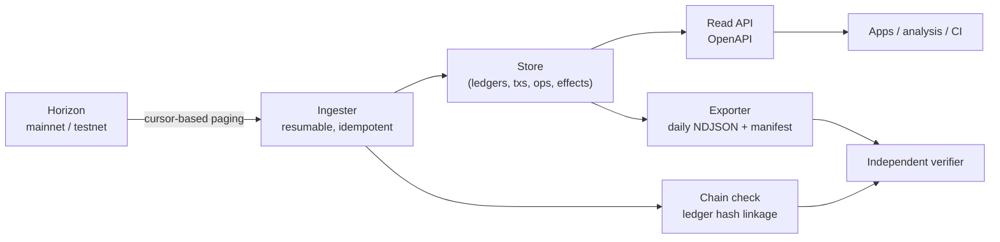

# RES-008 · An Open Pi Blockchain Explorer

> **Claim types:** `FACT` — official, dated, linked · `ANALYSIS` — this repository's reasoning, fallible ·
> `PROPOSAL` — a suggestion with no official status.

---

## 1. Executive Summary

There is already an official Pi block explorer at `blockexplorer.minepi.com` (`S-36`). Any proposal that
starts with "Pi needs an explorer" is therefore wrong on its first line. This document does not propose one.

What it proposes is a **complementary, open, self-hostable data layer**: a documented API, reproducible
exports, and verifiable provenance for what is displayed. `ANALYSIS` — An explorer UI answers "what happened?"
for a human. An open data layer answers "prove it" for a program. Those are different products, and the second
is the one that an ecosystem can build on without permission.

The strongest argument for this is not competition. It is **redundancy**: if the only way to read Pi's history
is through one interface, then every downstream analysis inherits that interface's assumptions, and an outage
or a change in presentation becomes an outage in everyone's understanding.

---

## 2. Problem Statement

| Need | Satisfied by a UI explorer? | Satisfied by an open data layer? |
|---|---|---|
| "Where did this payment go?" | Yes | Yes |
| "Give me every transaction for this address as CSV" | No | Yes |
| "Let me verify this dashboard offline" | No | Yes |
| "Run this query in CI" | No | Yes |
| "Show my app's users their transaction history" | No (no documented API) | Yes |
| "Prove the displayed history is unmodified" | Unclear | Yes, by design |
| "Decode a contract invocation" | Partly | Yes, with a schema |
| "Label this address as an exchange" | Sometimes, without evidence | Yes, with cited evidence and a dispute path |

`ANALYSIS` — The recurring pattern is **programmatic access**. A UI is a terminal; an ecosystem needs a socket.
Without one, every app that needs history builds its own indexer against Horizon, and each one makes different
choices about cursors, reorg handling, and confirmation depth — producing quietly incompatible numbers.

---

## 3. Current State

### 3.1 What exists

| Component | Detail | Source |
|---|---|---|
| Official explorer (UI) | `blockexplorer.minepi.com` | `S-36` |
| Chain API | Horizon-compatible Mainnet / Testnet | `S-60`, `S-61` |
| Chain semantics | Stellar-derived; `PaymentDTO` for platform payments | `S-05`, `S-06` |
| Contract layer | Soroban reference contracts | `S-55` |
| Protocol version | `28` observed | `M-01` |

### 3.2 What is not established

| Question | Status |
|---|---|
| Is there a documented public data API for the official explorer? | **Not found** (2026-10-25) |
| Are bulk exports offered? | **Not found** |
| Is historical retention published? | **Not found** |
| Is there a documented schema for decoded contract events? | **Not found** |
| Are address labels published with evidence? | **Not found** |
| Is the explorer's chain data independently verifiable by a third party? | Unknown — no published method found |

> As always: "not found" describes a public-documentation gap on a date, not a claim about internal capability.

---

## 4. Proposed Solution

`PROPOSAL` — Four deliverables, each useful alone.

| # | Deliverable | Description | Effort |
|---|---|---|---|
| 1 | **Indexer** | Horizon → local store, resumable, idempotent, re-verifiable | 2–3 weeks |
| 2 | **Read API** | Documented REST endpoints + `OpenAPI`; stable cursors; rate-limit headers | 1–2 weeks |
| 3 | **Export** | Daily immutable snapshots (NDJSON), content-addressed, with a manifest | 1 week |
| 4 | **Verifier** | Tool that re-checks a snapshot against Horizon for a claimed ledger range | 1 week |

### 4.1 The non-negotiable: provenance

Every response and every export must be able to answer *"how would I check this?"*

| Response field | Purpose |
|---|---|
| `ledger_sequence` | Where the fact lives |
| `closed_at` | When the network agreed |
| `source` | `horizon` or `derived` |
| `indexer_version` | Reproducibility |
| `snapshot_id` | Which export this data can be checked against |

`ANALYSIS` — A dashboard without these five fields is a claim. With them, it is evidence. The difference costs
almost nothing to implement and is almost never implemented.

### 4.2 What this explorer must refuse to do

| Refusal | Reason |
|---|---|
| Publish identity clustering ("these addresses belong to one person") | Unfalsifiable, harmful, and usually wrong |
| Show a price or valuation | Out of scope ([`DISCLAIMER.md`](../DISCLAIMER.md)) |
| Rank addresses by "wealth" as a leaderboard | Incentivises harm; no research value |
| Claim completeness beyond the indexed range | Silent truncation is worse than an honest gap |
| Display a label without evidence and a date | Labels decay; dates make decay visible |

---

## 5. Architecture

### 5.1 Ingestion and verification

### 5.2 Indexer rules

| # | Rule | Reason |
|---|---|---|
| E1 | Ingest by **cursor**, never by offset | Offsets duplicate and skip under concurrent writes |
| E2 | Store the ledger header hash and verify **linkage** between consecutive ledgers | Detects a gap that a cursor would hide |
| E3 | Every write is idempotent on `(ledger, tx_hash, op_index)` | Safe re-ingestion after a crash |
| E4 | Record the ingestion timestamp separately from `closed_at` | Distinguishes network time from observation time |
| E5 | Refuse to serve beyond the last **fully linked** ledger | Prevents serving an unverified tail |
| E6 | Re-ingest a configurable trailing window on every restart | Detects silent upstream corrections |

`ANALYSIS` — E2 and E6 are the two rules that separate a trustworthy indexer from a fast one. Most home-grown
indexers skip both, and the resulting gaps are invisible until someone reconciles totals.

### 5.3 Query surface (minimum)

| Endpoint | Purpose |
|---|---|
| `GET /ledgers/{seq}` | Header + hash + operation count |
| `GET /tx/{hash}` | Transaction, memo, result, ledger reference |
| `GET /account/{id}/payments` | Paginated payments with cursors |
| `GET /asset/{code}/{issuer}/holders` | Trustline holders (issued assets only) |
| `GET /contract/{id}/invocations` | Decoded contract calls (schema-dependent) |
| `GET /export/{date}` | Snapshot manifest + object links |
| `GET /health` | Last linked ledger, lag, indexer version |

### 5.4 Labels policy

| Rule | Detail |
|---|---|
| Evidence required | Every label carries a source URL and a date |
| Two-person review | A label affecting a third party requires a second reviewer |
| Dispute path | Anyone can dispute a label; disputes are public |
| Expiry | Labels older than 180 days are shown as `unverified` until re-checked |
| No inference from behaviour | "Exchange" requires a public statement, not a heuristic |

---

## 6. Benefits and Risks

### 6.1 Benefits

| Benefit | Who |
|---|---|
| Programmatic history without building an indexer | Every app |
| Reproducible analytics | Researchers, auditors |
| Redundancy against a single interface | Everyone |
| Contract visibility | Contract users |
| A verifiable public record | The ecosystem's credibility |

### 6.2 Risks

| Risk | Severity | Mitigation |
|---|---|---|
| **Indexer gaps** presented as complete history | Critical | E2/E5/E6; publish coverage explicitly |
| **Reorg / correction handling** misunderstanding | High | Re-ingest trailing window; show confirmation depth |
| **Storage cost** grows unboundedly | Medium | Retention policy per data class; exports are the archive |
| **Label bias or defamation** | High | Evidence + review + dispute + expiry |
| **Privacy harm** from over-eager clustering | High | Refuse clustering outright (§4.2) |
| **Becoming "the" explorer** and thus a single point of failure | High | Encourage forks; publish snapshots so others can serve |
| **Scope explosion** into a full product | Medium | Ship the API and export first; UI last, if ever |

---

## 7. Implementation Roadmap

| Phase | Deliverable | Exit criterion |
|---|---|---|
| 0 | Schema + ingestion design | A written data model with retention per table |
| 1 | Ledgers + payments only, Testnet | Re-ingest from scratch reproduces identical counts |
| 2 | Mainnet, read API, `OpenAPI` | A client generates from the schema and works |
| 3 | Daily export + manifest | An independent verifier confirms 1,000 ledgers |
| 4 | Contract invocations (once Mainnet contracts exist) | A decoded call matches the contract's event |
| 5 | Minimal UI **or** none, if others build on the API | Two independent consumers |

`ANALYSIS` — Phase 5 being optional is the point. If the API is good, the UI is someone else's weekend project,
and that is a healthier outcome than one canonical explorer.

---

## 8. Open Questions

1. Does the official explorer expose a documented API that this repository has not found? (`OQ-019`)
2. What is Horizon's historical retention, and does it cover genesis?
3. How should reorgs or ledger corrections be represented in an immutable export?
4. Is there an official address-label source, and would it be publishable with evidence?
5. What confirmation depth should be treated as final for Pi payments?
6. Are contract events emitted in a form that can be decoded without the ABI?
7. Would a community indexer be permitted, and at what request rate?
8. Who bears the cost of hosting historical exports?

See [`RES-012`](open-questions.md).

---

## 9. References

| # | Source | Type | Date |
|---|---|---|---|
| `S-05` | Horizon usage and native asset | Official | retrieved 2026-10-25 |
| `S-06` | `PaymentDTO` (platform-level payment object) | Official | pinned 2024-08-28 |
| `S-36` | Official Pi BlockExplorer | Official | retrieved 2026-10-25 |
| `S-55` | Soroban reference contract (events) | Official (code) | pinned 2026-04-17 |
| `S-60` | Mainnet Horizon endpoint | Official | retrieved 2026-10-25 |
| `M-01` | `protocol_version = 28` | Measurement | 2026-10-18 |

---

**Related:** [`RES-002`](rpc-infrastructure.md) · [`RES-011`](smart-contract-ecosystem.md) ·
[`RES-004`](pi-ecosystem-index.md) · [`PR-001`](../proposals/proposal-001-rpc-monitoring.md)
