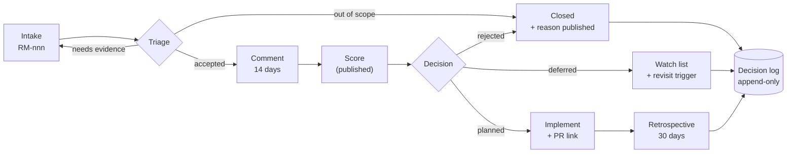

# RES-009 · A Community-Driven Developer Roadmap

> **Claim types:** `FACT` — official, dated, linked · `ANALYSIS` — this repository's reasoning, fallible ·
> `PROPOSAL` — a suggestion with no official status.

---

## 1. Executive Summary

A community roadmap is not a wish list with dates. It is a **decision process with a memory**.

The failure mode is well known and worth naming: a repository collects 300 issues, upvotes the most emotional
ones, publishes a "roadmap" with quarters attached, delivers a fraction, and never revisits the rest. Two years
later nobody can say why any item was dropped — so the same proposals return, and the process loses credibility
rather than gaining it.

`ANALYSIS` — The scarce resource in a community roadmap is not ideas. It is **the discipline to record
rejections**. A roadmap that only records what was accepted is a marketing artefact; one that records what was
refused, and why, is infrastructure.

This document specifies that process: intake, triage, comment periods, a published scoring model, a decision
log, implementation tracking, and a sunset rule. It is deliberately boring. Nothing here requires authority
that a community does not have.

---

## 2. Problem Statement

| Failure mode | Root cause | Symptom |
|---|---|---|
| Roadmap as wish list | No filtering | 200 items, 3 done |
| Priority by loudest voice | No published criteria | The most persistent person wins |
| Sybil voting | Vote counts as the decision | One group decides for everyone |
| Zombie proposals | No sunset rule | Items open for years with no status |
| Silent withdrawals | Rejections not recorded | Same idea returns every 6 months |
| False mandate | Claiming to speak for users | Credibility collapse on first disagreement |
| Drift from evidence | Scenarios treated as plans | Roadmap becomes fiction |

`ANALYSIS` — Every row is a **process** defect, not a technology defect. That is good news: process is cheap to
change, and it can be changed unilaterally by whoever is doing the work.

---

## 3. Current State

### 3.1 What exists to build on

| Asset | Relevance | Source |
|---|---|---|
| PiRC process (public RFCs on GitHub, reviewed via Issues/PRs) | The closest existing precedent for open design review | `S-52` |
| Official roadmap page | States the platform's direction; **not** a community artefact | `S-39` |
| GitHub issue trackers across `pi-apps` / `PiNetwork` | Where implementation discussion already happens | `S-06`, `S-52` |
| Public developer docs with a consolidation date | Shows a habit of publishing changelogs | `S-01`, `S-32` |
| Directory staking / ranking | An existing (opaque) prioritisation signal for apps | `S-27` |

### 3.2 What is missing

| Missing | Consequence |
|---|---|
| A published decision log with rejections | No institutional memory |
| A priority model that can be argued with | Priorities feel arbitrary |
| A comment period with a defined length | Reviews happen "whenever" |
| A sybil-resistant input method | Vote brigading |
| A sunset rule | Zombie items |
| A stated limit of authority | Overreach and disappointment |

> **The unglamorous constraint:** a community roadmap cannot commit anyone else's time. It can only rank work
> that volunteers are willing to do, and publish what it learned. Any roadmap that implies otherwise will be
> read as a promise and treated as a betrayal.

---

## 4. Proposed Solution

`PROPOSAL` — A seven-stage process, with one artefact per stage. If a stage has no artefact, it did not happen.

### 4.1 The process

| Stage | Input | Artefact | Duration |
|---|---|---|---|
| **1. Intake** | An issue using the template | Item with an ID (`RM-nnn`) and a named author | continuous |
| **2. Triage** | Item | One of: `accepted-for-scoring`, `needs-evidence`, `out-of-scope`, `duplicate` | 7 days |
| **3. Comment** | Accepted item | A thread; the author must answer every substantive objection or mark it unresolved | 14 days |
| **4. Score** | Item + published criteria | Four published numbers + a rank | 7 days |
| **5. Decide** | Score + objections | `planned` / `deferred` / `rejected` — **all three published with reasons** | 7 days |
| **6. Implement** | Planned item | A PR linking back to `RM-nnn`; status `in-progress` → `done` | as available |
| **7. Review** | Done item | A one-paragraph retrospective: did it work? | 30 days after |

### 4.2 The scoring model

Reuse the model in [`ROADMAP.md`](../ROADMAP.md) §2 — it is simple, and it is already published so it can be
attacked:

```
score = (impact × verifiability × adoptability) / effort
```

| Factor | Question | Anchors |
|---|---|---|
| **Impact** | How many builders or users are blocked? | 5 = blocks all payments work; 1 = cosmetic |
| **Verifiability** | Can completion be checked by a stranger? | 5 = binary test; 1 = opinion |
| **Adoptability** | Can one team do it without permission? | 5 = a single volunteer; 1 = requires platform change |
| **Effort** | Days, including review | 1 = under a day; 5 = over a month |

`ANALYSIS` — The model's purpose is not accuracy. It is **disagreement**. "I think impact is 3, not 5, because…"
is a productive conversation. "I want this more" is not.

### 4.3 Input without sybil voting

| Input | Weight | Reason |
|---|---|---|
| A written use case with evidence | **High** | Expensive to fake, useful to read |
| A working prototype | **Very high** | The strongest possible argument |
| A named implementer | **High** | Converts desire into capacity |
| A 👍 reaction | Low (signal only) | Cheap to fake |
| A comment count | Low (signal only) | Measures heat, not value |
| A poll | **Not used for decisions** | Trivially gamed; produces false mandates |

`ANALYSIS` — The rule "no named implementer, no `planned` status" is the single most effective filter available
to a volunteer project. It is also the most unpopular. It is still correct: a roadmap of unstaffed items is a
list of promises nobody made.

### 4.4 Decision log format

| Field | Content |
|---|---|
| `id` | `RM-014` |
| `title` | One line |
| `decision` | `planned` / `deferred` / `rejected` / `superseded` |
| `date` | `YYYY-MM-DD` |
| `score` | The four numbers |
| `reason` | **Mandatory for every non-planned outcome** |
| `objections` | Substantive objections and how they were resolved or left open |
| `revisit` | A date or a trigger condition |

---

## 5. Architecture

### 5.1 The loop



### 5.2 Roles and their limits

| Role | May do | May **not** do |
|---|---|---|
| **Author** | Propose, revise, withdraw | Decide their own item's priority |
| **Reviewer** | Challenge evidence, request changes | Block without a written reason |
| **Maintainer** | Triage, publish decisions, merge | Commit anyone else's time |
| **Steward** (optional) | Break ties, guard the process | Veto technical merit unilaterally |
| **Anyone** | Open an issue, dispute a decision | Speak for the community as a whole |

### 5.3 Invariants

| # | Invariant | Protects |
|---|---|---|
| V1 | Every item ends in an explicit state | No zombies |
| V2 | Every rejection has a written reason | Memory |
| V3 | No `planned` item without a named implementer | Honesty |
| V4 | Scores are published before decisions | Fairness |
| V5 | Polls never decide | Sybil resistance |
| V6 | The roadmap states what it cannot commit | Credibility |
| V7 | A decision can be reopened only with new evidence | Prevents churn |

---

## 6. Benefits and Risks

### 6.1 Benefits

| Benefit | Evidence it is working |
|---|---|
| Contributors stop re-litigating settled ideas | Fewer duplicate proposals |
| Priorities become arguable | Disagreements cite a number, not a person |
| Rejections stop feeling arbitrary | Reasons are readable |
| Volunteers self-select | Items get implementers before status |
| The process survives its founders | Decisions live in a log, not in memory |

### 6.2 Risks

| Risk | Severity | Mitigation |
|---|---|---|
| **Bureaucracy** — process exceeds output | High | Seven stages, each ≤ 14 days; skip scoring for editorial work |
| **Maintainer capture** | High | V3, V4; publish the log; allow forks to diverge openly |
| **False mandate** — readers think it binds Pi | High | V6 stated in the first paragraph of every output |
| **Low participation** — nobody comments | Medium | Publish items in batches; comment on your own proposals |
| **Score gaming** — inflate impact | Medium | Anchors in §4.2; require evidence per score |
| **Burnout** | High | Explicitly allow items to be `deferred` for lack of capacity — that is not failure |
| **Roadmap becomes a wish list anyway** | High | V3 is the guard; if it is relaxed, the process is dead and should be retired honestly |

---

## 7. Implementation Roadmap

| Phase | Deliverable | Exit criterion |
|---|---|---|
| 0 | Publish this process + templates | A stranger can submit without asking a question |
| 1 | First 10 items triaged with published decisions | Every one has a state and a reason |
| 2 | First item moves `planned` → `done` | A PR links to an `RM-nnn` |
| 3 | First rejection disputed and upheld (or overturned) | The dispute path works in practice |
| 4 | First retrospective | A "done" item is assessed honestly |
| 5 | Annual process review | The process itself has a decision record |

---

## 8. Open Questions

1. Should this process live in this repository, or in a dedicated governance repository? (`OQ-021`)
2. Who are the initial maintainers, and how is that role transferred?
3. Is `PiRC` an appropriate venue for community proposals, or only for platform-internal design?
4. How should a proposal that requires platform changes be handled — `deferred` or a distinct state?
5. What is the minimum evidence for an "impact = 5" score?
6. Should the decision log be append-only in Git, or a generated site?
7. How does this relate to official roadmap publications without implying endorsement?

See [`RES-012`](open-questions.md).

---

## 9. References

| # | Source | Type | Date |
|---|---|---|---|
| `S-01` | Developer docs | Official | 2026-09-04 |
| `S-06` | Platform docs repository (issue precedent) | Official | pinned 2024-08-28 |
| `S-27` | Directory staking / ranking | Official | 2026-06-18 |
| `S-32` | Docs consolidation (changelog habit) | Official | 2026-09-04 |
| `S-39` | Official roadmap page | Official | retrieved 2026-10-25 |
| `S-52` | PiRC — public RFC review precedent | Official (RFC) | retrieved 2026-10-25 |
| `ROADMAP` | This repository's own priority model | This repo | 2026-10-25 |

---

**Related:** [`ROADMAP.md`](../ROADMAP.md) · [`RES-012`](open-questions.md) ·
[`CONTRIBUTING.md`](../CONTRIBUTING.md) · [`PR-003`](../proposals/proposal-003-ecosystem-directory.md)
