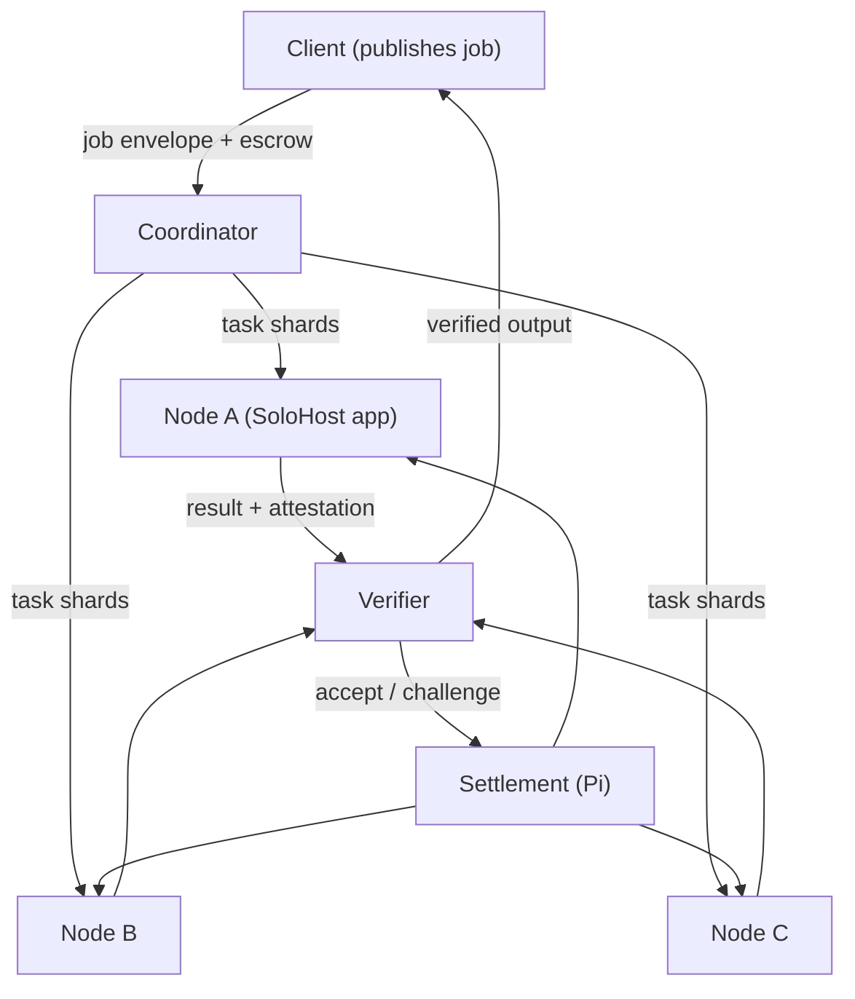

# RES-007 · Decentralized Computing: Opportunities and Limitations

> **Claim types:** `FACT` — official, dated, linked · `ANALYSIS` — this repository's reasoning, fallible ·
> `PROPOSAL` — a suggestion with no official status.

---

## 1. Executive Summary

Pi has an unusual asset: an official claim of **420,000+ Node runners** (`S-31`), each running software on a
machine they own. In August 2026 Pi completed an initial **distributed-computing test** through a SoloHost app
with **five volunteer Node runners**, validating "the end-to-end flow of tasks across real devices, including
connecting to a Pi coordinator, receiving and processing computing jobs, and reporting results back", with
participating Nodes compensated in Pi by third-party clients (`S-29`).

That is a proof of concept, not a compute market. `ANALYSIS` — The distance between them is not primarily
about hardware. It is about **verification**: a compute marketplace without a way to check that a result is
correct is a marketplace for trusting strangers with your data and your money.

This document separates three questions that are usually conflated — *can it be scheduled*, *can it be
verified*, and *can it be paid for* — and argues that only the second is genuinely hard.

---

## 2. Problem Statement

Take the official description at face value: a coordinator distributes jobs, nodes process them, results come
back, clients pay in Pi. What could go wrong?

| Failure | Consequence | Is it solved by scheduling? |
|---|---|---|
| A node returns a wrong result | Client pays for garbage | No |
| A node returns a *plausible* wrong result | Silent corruption | No |
| A node steals the input data | Data breach | Partly (sandboxing) |
| A node withholds a result to extort | Stall | No |
| A client refuses to pay | Node works for free | Partly (escrow) |
| A job is illegal or abusive | Legal exposure for the network | No |
| A node goes offline mid-job | Retry cost | Yes (redundancy) |
| Residential bandwidth is the bottleneck | Slow jobs | Partly (job classing) |

`ANALYSIS` — Every row except the last two is a **trust** problem with no purely technical fix. The compute
literature has three answers — redundant recomputation, trusted hardware, and cryptographic proofs — and all
three trade cost for confidence. A Pi compute market must pick a tier per job class and say so publicly.

---

## 3. Current State

### 3.1 What exists (official)

| Element | Detail | Source | Maturity |
|---|---|---|---|
| Node base | `420,000+` Node runners (official claim) | `S-31` | Claimed |
| Node software | Pi Node 0.6.2; UPnP port automation; port checker | `S-29` | Released |
| Self-hosted runtime | SoloHost in Pi Desktop; open, permissionless publisher flow; **beta** | `S-28`, `S-31` | Beta |
| Containment | SoloHost apps run in a container that restricts default access to the host | `S-31` | Beta |
| Prior PoC | OpenMind case study — exploring decentralized AI training/compute on the Node network | `S-34` | PoC |
| Compute test | 5 volunteer Nodes; tasks sent automatically via a SoloHost app; results reported back | `S-29` | PoC complete |
| Coordinator | "Pi coordinator" referenced as the task source | `S-29` | Exists, undocumented |
| Payment | Participating Nodes "can be compensated by the third-party clients in Pi" | `S-29` | Stated, unspecified |
| Intent | "production-level utility for third-party clients" | `S-29` | Stated goal |

### 3.2 What is not specified

| Missing | Why it blocks a market |
|---|---|
| Result verification method | Nobody can price risk |
| Task envelope / job protocol | Every client invents one |
| Pricing and settlement terms | Nodes cannot compute expected return |
| Hardware requirements per job class | Eligibility is unclear |
| Data handling and retention rules | Clients cannot assess confidentiality |
| Slashing / dispute resolution | No remedy for a bad result |
| Abuse policy | Legal exposure unmanaged |
| Uptime expectations | Scheduling is unreliable by construction |

> **Do not over-read the PoC.** Five Nodes completing tasks proves the plumbing works. It does **not** prove
> that results were verified — the official text describes a flow, not a correctness check. Treat "verified
> compute" as unestablished (`SOURCES.md` §5).

### 3.3 Node ≠ validator

`ANALYSIS` — A recurring confusion is worth stating explicitly: running a Pi Node does not, by itself, confer
consensus authority. Node participation supports the network and, increasingly, hosts apps and compute. The
quorum/validator configuration is a separate matter and is not established by this repository
(`SOURCES.md` §5). Any compute design that assumes "nodes validate the chain, therefore nodes are
trustworthy" is making an unjustified leap.

---

## 4. Proposed Solution

`PROPOSAL` — A tiered job protocol: **the verification tier is a property of the job, chosen by the client,
and priced accordingly.** No single verification method is imposed, because different jobs need different
guarantees.

### 4.1 Verification tiers

| Tier | Method | Trust assumption | Cost multiple | Suitable for |
|---|---|---|---|---|
| **T0** | Self-report, no check | You trust the node | 1× | Non-critical batch work, your own nodes |
| **T1** | Recomputation by *k* independent nodes; majority or unanimity | At least one honest node in *k* | *k*× | Most batch jobs |
| **T2** | Trusted execution attestation | Hardware vendor + attestation chain | 1× + attestation overhead | Confidential inference |
| **T3** | Cryptographic proof (e.g. verifiable computation, ZK) | The proof system | 10–10,000× today | High-value, small-output jobs |
| **T4** | Optimistic: result accepted, challengeable within a window, challenger stakes | Economics (stake > gain from cheating) | 1× + insurance | Long jobs with delayed consumption |

`ANALYSIS` — T1 is the workhorse. It is unglamorous, it is what BOINC-style systems have used for decades, and
it is the only tier that is both cheap and understandable. T4 is the interesting one for a Pi-native design,
because the chain already provides the escrow and the timestamp that a challenge window needs.

### 4.2 Job classes worth targeting (and ones to avoid)

| Class | Fit for 420k consumer Nodes | Why |
|---|---|---|
| Embarrassingly parallel batch (rendering frames, transcoding, dataset labelling) | **Good** | Chunked, verifiable by recompute, no tight deadlines |
| Small-model inference at the edge | **Good** | Fits the hardware; latency tolerance varies |
| Distributed training of large models | **Poor** | Interconnect and bandwidth dominate; this is a datacentre problem |
| Low-latency serving (APIs at <100 ms) | **Poor** | Residential networks and churn |
| Long-running stateful services | **Poor** | Nodes are not reliably available |
| Data processing that must not leave a jurisdiction | **Conditional** | Requires verifiable geolocation, which is hard |

`ANALYSIS` — The honest framing for Pi compute is **"batch and edge inference on hardware that is already on"**,
not "a decentralized AWS". The economics only work because the capital cost is already sunk; the moment a job
requires a datacentre-grade SLA, the model breaks.

### 4.3 Economics, stated as ranges rather than promises

| Variable | Observation | Consequence |
|---|---|---|
| Hardware cost | Sunk (users already own machines) | Marginal cost ≈ electricity + wear |
| Electricity | Highly variable by region | A global uniform price is impossible |
| Bandwidth | Often metered, asymmetric upload | Large data transfer can cost more than compute |
| Reward currency | Pi (`S-29`) | Node operators bear Pi price risk; this repository takes no view on price |
| Utilisation | Unknown | Without data, no one can promise returns |

> **No yield estimates appear in this document, deliberately.** Any number would be a price-dependent
> projection, which is out of scope by [`DISCLAIMER.md`](../DISCLAIMER.md) §2.

---

## 5. Architecture

### 5.1 Reference topology



### 5.2 The job envelope (minimum fields)

```json
{
  "schema": "pi-compute-job/1",
  "job_id": "uuid",
  "class": "batch-render",
  "verification_tier": "T1",
  "redundancy": 3,
  "input": { "ref": "content-addressed-uri", "sha256": "..." },
  "output": { "format": "sha256-of-artifact" },
  "constraints": { "min_ram_gb": 8, "max_runtime_s": 900, "network": "download-only" },
  "payment": { "amount_pi": "…", "escrow_ref": "…", "release": "on-verify" },
  "deadline": "2026-11-01T00:00:00Z",
  "privacy": { "input_confidential": false, "retention": "delete-on-verify" }
}
```

Two fields carry most of the design's weight: `verification_tier` (which determines cost) and `privacy`
(which determines whether T2 is required). A protocol without those two is a queue, not a market.

### 5.3 Invariants

| # | Invariant | Why |
|---|---|---|
| C1 | Output is content-addressed; a result without a hash is not a result | Prevents "trust me" completion |
| C2 | Payment releases only on the job's stated verification tier passing | Aligns incentive with correctness |
| C3 | A node's reputation is derived from verified outcomes, never self-reported | Sybil resistance |
| C4 | Confidential jobs must never route to T0 | Data protection |
| C5 | Every job is attributable to a client with a stake or a deposit | Abuse deterrence |
| C6 | Container isolation is a default, not a setting | Host safety (`S-31` describes containment) |

---

## 6. Benefits and Risks

### 6.1 Opportunities

| Opportunity | Precondition |
|---|---|
| Monetising idle hardware | A verification tier that clients accept |
| Cheaper batch processing than cloud | Utilisation high enough that overhead amortises |
| Regional data processing | Verifiable location (currently hard) |
| A path from "node runner" to "service provider" | Legal clarity and abuse controls |
| Practical AI inference close to users | Latency budget that tolerates churn |

### 6.2 Risks

| Risk | Severity | Mitigation |
|---|---|---|
| **Unverifiable results** | Critical | Tier per job; never claim verification that is not performed |
| **Abuse** — illegal content, malware, scraping | High | Client accountability (C5), job class allow-list, reporting |
| **Data leakage** from confidential jobs | High | T2 or no confidential jobs |
| **Node churn** causing systematic job failure | High | Redundancy, deadlines, partial credit |
| **Sybil nodes** farming rewards without work | High | Verified-outcome reputation; stake |
| **Legal exposure** across jurisdictions | High | Terms, geofencing, abuse policy; not solved here |
| **Overpromising** to node operators | High | No yield figures; state the price risk explicitly |
| **Host compromise** via a malicious SoloHost app | High | Official guidance is "assess packages, install at own risk" (`S-31`) — treat as beta |

---

## 7. Implementation Roadmap

| Phase | Deliverable | Prerequisite | Exit criterion |
|---|---|---|---|
| 0 | Publish the job envelope + tier definitions | This document | A third party can implement a client |
| 1 | Simulated coordinator with fake nodes and T1 verification | Phase 0 | Corruption injected into one node is detected |
| 2 | Real 3-node test with T1, non-confidential job | Existing Node network | Result reproducible from hashes |
| 3 | Escrow prototype using Testnet assets | Contracts on Testnet (`S-26`) | Payment releases only on verification |
| 4 | Public metrics: jobs, failures, verification outcomes | Phase 3 | Numbers anyone can re-derive |
| 5 | Dispute process and abuse policy | Phase 4 | A disputed job resolves with a written record |

`ANALYSIS` — Phase 1 is where this proposal earns its keep: a simulator that deliberately lies is the only
credible way to demonstrate that the verification tier works. A demo where every node is honest proves
nothing.

---

## 8. Open Questions

1. How, if at all, were the five-node PoC results verified? (`OQ-017`)
2. What is the Pi coordinator's API, and is it documented or proprietary?
3. How is compensation calculated and settled? (per job, per hour, per result?)
4. Are there hardware minimums, and are they enforced or advisory?
5. Who is liable if a node processes illegal content?
6. Is confidential computing (T2) available on typical consumer hardware in the Node population?
7. Does node eligibility depend on the same permissioning as consensus participation? (`OQ-007`)
8. What stops a client from publishing a job and never paying? (`OQ-018`)

See [`RES-012`](open-questions.md).

---

## 9. References

| # | Source | Type | Date |
|---|---|---|---|
| `S-28` | Pi2Day 2026 (SoloHost beta) | Official | 2026-06-28 |
| `S-29` | Node 0.6.2 + distributed-computing test | Official | 2026-08-14 |
| `S-31` | 420,000+ Node runners; SoloHost beta; user risk | Official | 2026-08-27 |
| `S-34` | OpenMind case study (prior PoC) | Official | unpinned |
| `S-35` | Pi Node product page | Official | retrieved 2026-10-25 |
| `S-55` | Allowance semantics (for escrow sketch) | Official (code) | pinned 2026-04-17 |

---

**Related:** [`RES-001`](pi-network-future.md) · [`PR-005`](../proposals/proposal-005-decentralized-services.md) ·
[`RES-006`](security-and-trust.md) · [`SOURCES.md`](../SOURCES.md) §5
