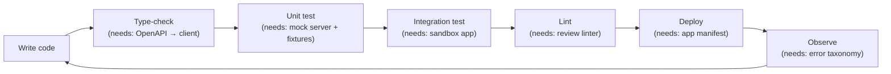

# RES-005 · Missing Developer Tools

> **Claim types:** `FACT` — official, dated, linked · `ANALYSIS` — this repository's reasoning, fallible ·
> `PROPOSAL` — a suggestion with no official status.

---

## 1. Executive Summary

Pi's developer surface improved materially in 2026: documentation was consolidated at `docs.minepi.com`
(`S-01`, `S-32`), `@pinetwork/pi-sdk-js` reached 2.0.0 (`S-09`), local storage and a staking data API appeared
(both whitelisted), `Pi.shareFile` shipped, and App Studio lowered the cost of *starting* an app (`S-30`).

`ANALYSIS` — The remaining gap is no longer "how do I begin". It is "how do I **not ship a bug**". The tooling
that prevents mistakes — typed clients, a local mock of the platform API, webhooks, a documented error
taxonomy, fixtures for CI, contract bindings, and an app manifest — is largely absent. Those are the tools that
separate a demo from a product.

This is not a criticism of what exists. It is a list of what a developer must currently build **for
themselves**, and therefore what every Pi app rebuilds slightly differently and slightly wrong.

---

## 2. Problem Statement

A developer can build a Pi app. Then they hit the second wall:

| Moment | What they need | What exists | Consequence |
|---|---|---|---|
| First backend call | A typed client for the Platform API | Prose docs + a `PaymentDTO` snippet (`S-06`) | Hand-written types drift from reality |
| First test | A mock server that behaves like the platform | Nothing public | Tests hit a real API or are not written |
| First failure | A list of error codes and what to do | Scattered in prose | `catch (e) { retry() }` on a permanent error |
| First payment | A worked example of verification order | Two partial examples (`S-07`, `S-08`) | Order is guessed; double-delivery bugs |
| First contract | TS bindings, a local harness | Rust SDK (`S-55`) | App devs cannot call contracts comfortably |
| First deployment | A checklist and a manifest | Nothing | Permissions and disclosures are undocumented |
| First review | A static check for common mistakes | Nothing | Every reviewer starts from zero |

`ANALYSIS` — The pattern is consistent: Pi's tooling optimises **happy-path creation** (App Studio, docs, SDK)
and under-invests in **failure-path prevention** (tests, types, mocks, errors). Creation is visible and
celebrated; prevention is invisible and only shows up as a security incident six months later.

---

## 3. Current State

### 3.1 Inventory — what exists (2026-10-25)

| Tool | What it does | Source | Limitation |
|---|---|---|---|
| `docs.minepi.com` | Consolidated developer docs | `S-01`, `S-32` | Living site, unpinned, no changelog |
| `@pinetwork/pi-sdk-js@2.0.0` | Client SDK; `createPayment`, auth, wallet, share | `S-09` | Requires Pi Browser (`S-02`) |
| Platform API | Server-side payment lifecycle | `S-06`, `S-07` | Prose schema; no OpenAPI |
| `pi-platform-docs` | `PaymentDTO`, payments flow | `S-06`, `S-07` | Last commit 2024-08-28 — older than the platform |
| Demo app (`demo.pi`) | Reference app | `S-11`, `S-12` | PiOS-licensed; not a test harness |
| PiOS | Licence + registry for community apps/libraries | `S-13` | Licence, not a package manager |
| App Studio | Generative app creation, Pi payments integration | `S-30` | Pricing changed 2026-08-24; not a dev environment |
| Sandbox | Test app registration / environment | `S-11`, `S-01` | Behaviour differences from Mainnet undocumented |
| Local storage | On-device storage, **whitelisted** | `S-32` | Not permanent; per-app approval |
| Staking Data API | Effective stake for the requesting app, **whitelisted** | `S-32` | Access gated |
| `Pi.shareFile` | Native share sheet for files/video | `S-32` | Client-side only |
| Official explorer | Chain browsing | `S-36` | UI-first; no documented public data API |
| Horizon endpoints | Chain reads | `S-60`, `S-61` | No published limits |

### 3.2 What a developer must currently build themselves

| Missing | Workaround used today | Cost |
|---|---|---|
| Typed Platform API client | Hand-written interfaces | Divergence on every API change |
| `OpenAPI` description | None | Codegen impossible |
| Mock platform server | None — tests are skipped or hit production | Payment bugs found in production |
| Webhook / event delivery | Polling | Wasted requests; missed transitions |
| Documented error taxonomy | Read source of errors ad hoc | Blind retries on permanent failures |
| CI fixtures for payments | None | No regression safety |
| Contract client generation | Manual XDR construction | High barrier to contracts |
| App manifest | None | Permissions undiscoverable |
| Linter for common mistakes | None | Reviews are inconsistent |
| Localisation guidance | None | 60M+ users, uneven language coverage |

> **On the "official vs community" distinction:** several gaps above could be closed by the platform team and
> several by the community. This document does not assume which. It assumes only that *nobody* closing them is
> the current state, and that a community version is possible for most.

---

## 4. Proposed Solution

`PROPOSAL` — Eight tools, ordered by leverage per unit of effort. Each is specified well enough that one
person could start it this week.

| # | Tool | Form | Effort | Impact |
|---|---|---|---|---|
| 1 | **Payment verification reference** | ~150-line server example with tests, in 2 languages | 2 days | Very high |
| 2 | **Platform API mock server** | Local HTTP server implementing the documented lifecycle | 3 days | Very high |
| 3 | **Error taxonomy** | Table: code → cause → retryable? → action | 1 day | High |
| 4 | **`OpenAPI` description** | Derived from public docs, no credentials | 4 days | High |
| 5 | **App manifest schema** | `pi-app.json` + validator | 2 days | High |
| 6 | **CI recipe** | GitHub Action: lint + mock-based tests + manifest validation | 1 day | Medium–High |
| 7 | **Contract client generator** | Soroban bindings → TS | 2 weeks | Medium (grows with contracts) |
| 8 | **Review linter** | Static checks for the §2 mistakes | 1 week | Medium |

Items 1, 3, 5 and 6 are specified in [`PR-002`](../proposals/proposal-002-developer-standards.md).

### 4.1 Why a mock server is the highest-leverage missing tool

`ANALYSIS` — Payments are the one part of a Pi app where a bug costs real money and cannot be fixed by a
redeploy. Right now, testing a payment path means either (a) manually driving the Pi Browser against a real
account, or (b) not testing it. A local mock that reproduces the documented lifecycle — create, approve,
transact, complete, cancel — turns a manual ritual into an automated test.

The mock must be **explicitly documented as a mock**: it cannot reproduce rate limits, real latency, or
undocumented platform behaviour. Its purpose is to test *your* logic, not to predict theirs.

### 4.2 What the mock must model (minimum)

| Event | Behaviour to model |
|---|---|
| `createPayment` | Returns an identifier; not yet approved |
| Server approval | Moves to approved; idempotent on repeat |
| User cancellation | Emits a cancellation the client must handle |
| Blockchain transaction | Settles to a `txid` the server can verify |
| Server completion | Moves to completed; **delivery must happen only after this** |
| Failure injection | Timeout, 500, 429, malformed body, duplicate completion |
| Replay | Same idempotency key must not double-charge |

`ANALYSIS` — The last row is where most real incidents live. A mock that cannot replay a request is a mock
that cannot test the property that matters.

---

## 5. Architecture

### 5.1 Where the missing tools sit in a developer's loop



Every arrow is currently a place where a developer improvises. Improvisation is not a character flaw; it is
what happens when a step has no tool.

### 5.2 Reference sketch — verification order

The ordering below is the crux of a correct payment integration, and the thing a reference implementation
should make impossible to get wrong:

```js
// Illustrative. Field names follow the published PaymentDTO (S-06).
// 1) Approve the payment server-side.
await pi.post(`/v2/payments/${paymentId}/approve`);

// 2) Wait for the client to submit the blockchain transaction and
//    report completion — but do NOT trust the client's word.

// 3) On completion, read the payment from the platform...
const payment = await pi.get(`/v2/payments/${paymentId}`);

// 4) ...then verify independently on the chain before delivering value.
//    Check: txid exists, destination matches, amount >= price,
//    asset is native, memo/payment id matches, ledger validated.
const settled = await verifyOnChain(payment.transaction?.txid, {
  destination: MERCHANT_ADDRESS,
  minAmount: price,
  nativeOnly: true,
  memo: paymentId
});
if (!settled) return reject('not settled');

// 5) Only now complete and deliver.
await pi.post(`/v2/payments/${paymentId}/complete`);
await deliver(paymentId); // idempotent by paymentId
```

`ANALYSIS` — Steps 4 and 5 are the two that are most often skipped or reordered. A reference implementation
with tests for the reordered variants would prevent more loss than any amount of documentation.

### 5.3 Design constraints

| Constraint | Effect on tooling |
|---|---|
| SDK auth/payments only inside Pi Browser (`S-02`) | Tooling must support a browser-less backend path for tests |
| Whitelisted capabilities (`S-32`) | Tools must degrade when a capability is unavailable, not crash |
| No published rate limits | Mock and clients must model backpressure configurable by the developer |
| Chain is the settlement layer (`S-04`) | Verification tooling must read Horizon, not only the platform API |
| Unpinned living docs | Generated types must record the doc retrieval date |

---

## 6. Benefits and Risks

### 6.1 Benefits

| Benefit | Measurement |
|---|---|
| Fewer payment incidents | Count of double-delivery bugs reported |
| Faster onboarding | Time from clone to passing payment test |
| Better reviews | Linter findings per PR, consistently applied |
| Reusable code | Number of apps importing the same reference package |
| Fewer "is it down?" threads | Support questions tagged `api` |

### 6.2 Risks

| Risk | Severity | Mitigation |
|---|---|---|
| **Mock drift** — mock diverges from real platform | High | Version the mock against a dated doc; label it explicitly |
| **False confidence** — passing tests read as production-ready | High | Document what the mock cannot model |
| **Maintenance burden** on volunteers | High | Small surface area; one maintainer per tool; archive rather than rot |
| **Fragmentation** — three mocks, none complete | Medium | Publish one; invite forks only for genuine divergence |
| **Accidental credential use against production** | High | Hard-code the mock to localhost; require an explicit flag for real endpoints |
| **Teaching the wrong order** in examples | Very high | Every example tested against a reordering that must fail |

---

## 7. Implementation Roadmap

| Sprint | Deliverable | Exit criterion |
|---|---|---|
| 1 | Error taxonomy table + payment verification example | Two people independently implement the order correctly |
| 2 | Mock server covering the seven events in §4.2 | A test suite passes against it, including replay |
| 3 | CI recipe using the mock | A template repo goes green from a cold clone |
| 4 | `OpenAPI` description from public docs | Generated client compiles |
| 5 | Manifest schema + validator | One real app validates |
| 6 | Contract bindings (when contracts reach Mainnet) | A TS app calls a read-only contract method |

---

## 8. Open Questions

1. Are there official error codes documented anywhere, and are they stable? (`OQ-013`)
2. Does the Platform API support webhooks, or only polling? (`OQ-014`)
3. What exactly differs between sandbox and Mainnet behaviour?
4. Are there published rate limits that a mock should emulate?
5. Would a community-maintained client be acceptable to the platform team, or is it considered unofficial?
6. Are contract bindings planned, or is manual XDR the intended path?
7. What are the criteria for whitelisted capabilities, and can a community tool qualify?

See [`RES-012`](open-questions.md).

---

## 9. References

| # | Source | Type | Date |
|---|---|---|---|
| `S-01` | Consolidated developer docs | Official | 2026-09-04 |
| `S-02` | Pi Browser requirement for SDK auth/payments | Official | retrieved 2026-10-25 |
| `S-04` | Blockchain as source of truth | Official | retrieved 2026-10-25 |
| `S-06` | `PaymentDTO` | Official | pinned 2024-08-28 |
| `S-07` | Three-phase payment flow | Official | retrieved 2026-10-25 |
| `S-08` | A2U integration guide | Official | pinned 2023-01-27 |
| `S-09` | `@pinetwork/pi-sdk-js@2.0.0` | Official | 2026-03-19 |
| `S-13` | PiOS licence + registry | Official | retrieved 2026-10-25 |
| `S-30` | App Studio pricing change | Official | 2026-08-17 |
| `S-32` | Local storage, staking API, `Pi.shareFile` | Official | 2026-09-04 |
| `S-55` | Soroban reference contract | Official (code) | pinned 2026-04-17 |

---

**Related:** [`RES-006`](security-and-trust.md) · [`RES-002`](rpc-infrastructure.md) ·
[`PR-002`](../proposals/proposal-002-developer-standards.md) · [`RES-011`](smart-contract-ecosystem.md)
