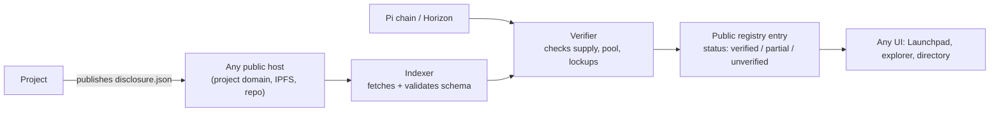

# RES-003 · The Future of Pi Launchpad

> **Claim types:** `FACT` — official, dated, linked · `ANALYSIS` — this repository's reasoning, fallible ·
> `PROPOSAL` — a suggestion with no official status.

---

## 1. Executive Summary

Pi Launchpad is a genuinely unusual design. In the official description, the Pi raised in a token sale is
**not paid to the project team** — it becomes liquidity in a Pi/token pool (`S-24`, `S-53`). Participation is
weighted by *PiPower*, derived from staked Pi, with a baseline referencing a long lockup of mined Pi (`S-53`).

At the evidence cut-off the Launchpad is a **Pi App on Testnet with a test token**; the Mainnet version is
explicitly pending, and the design is explicitly subject to change (`S-24`). PiRC1 is an RFC (`S-52`).

`ANALYSIS` — The design solves a real problem (launch-and-dump incentives) and creates a new one: with no
proceeds to the team, the *reason to launch well* moves entirely to the token's product utility — which means
the quality of a launch can no longer be inferred from "the team raised money and is therefore committed".
Investors must evaluate the product directly. That is better in principle and much harder in practice,
because **nothing in the launch process currently produces comparable, machine-readable disclosures**.

This document examines what the design gets right, where the information asymmetry now sits, and what a
minimum disclosure standard would look like. The concrete standard is
[`PR-004`](../proposals/proposal-004-launchpad-transparency.md).

---

## 2. Problem Statement

A Pioneer considering a launch participation currently faces an evaluation problem with no support:

| Question a participant should be able to answer | Available today |
|---|---|
| What does this project's product actually do, and does it exist? | A Launchpad listing and a marketing page |
| How much of the token supply is circulating at launch? | Varies by project |
| Who holds the rest, and under what lockup? | Varies by project |
| What determines my allocation (PiPower formula in effect)? | The PiRC, at a version that may have changed |
| What happens to the Pi I contribute? | Officially: it becomes liquidity (`S-24`) — but the pool's parameters are project-specific |
| What is the project obliged to report afterwards? | Nothing standardised |

`ANALYSIS` — When the answer to "what am I buying" differs in *format* between two launches, comparison is
impossible and marketing wins by default. The information problem is therefore not "projects lie" — it is that
**projects are not asked the same questions in the same shape**.

There is a second problem specific to this design. Because proceeds become liquidity rather than revenue:

| Consequence | Why it matters |
|---|---|
| The project does not need the raise to survive | Good: no runway pressure to dump. Bad: no financial signal of commitment |
| The token must have *product* utility from day one | Official design requires product-first projects (`S-24`) — but "has a working app" is not a measurable criterion |
| Liquidity is the founding asset | Pool depth and lock duration become the primary risk parameters, not the raise amount |

---

## 3. Current State

### 3.1 The mechanism, as officially described

| Element | Official description | Source | Status |
|---|---|---|---|
| Framework | "fair, transparent, community-first and engagement-oriented token launch framework built natively on the Pi ecosystem" | `S-53` | RFC |
| Proceeds | "never transfers the proceeds of a token launch sale to the project team — instead, all Pi sold becomes liquidity" | `S-53` | RFC |
| Transparency claim | "on-chain transparency of the launch process ensured by immutable smart contracts" | `S-53` | RFC |
| Participant weighting | Users stake Pi to receive *PiPower*; baseline rule references an "active Pi lockup of ≥90% of their mined tokens for at least 3 years" | `S-53` | RFC |
| Post-launch | Pool remains accessible for "Pi ↔ token swaps" or new liquidity deposits | `S-53` | RFC |
| Design variant implemented | "Design 1" of the PiRC | `S-24` | Testnet |
| Release | Initial version as a Pi App on **Testnet**, with a test token | `S-24` | 2026-03-19 |
| Mainnet | Pending at evidence cut-off; design "subject to change" | `S-24` | pending |
| DEX | Exists on **Testnet** | `S-24` | Testnet |
| Ecosystem tokens | Design released on Mainnet, 2026-02-20 | `S-23` | live |

> **Read the status column, not the prose.** Every mechanism above is an RFC or a Testnet behaviour. A
> document that cites it as settled Mainnet behaviour would be wrong, and this repository will not do that.

### 3.2 What the official material does not specify (as of 2026-10-25)

| Gap | Why it blocks evaluation |
|---|---|
| A standard launch-disclosure format | No two launches are comparable |
| Published PiPower formula at a given block/date | Participants cannot compute their own weight in advance |
| A project-approval process and its criteria | "Who may launch" is unclear; so is "who refused, and why" |
| Post-launch reporting obligations | Nothing to hold a project to after the sale |
| Pool parameter norms (initial depth, lock duration) | The main risk parameter is unbounded |
| Treatment of a failed or abandoned project | No stated wind-down path |

`ANALYSIS` — Note the asymmetry: the *mechanics* are unusually transparent (proceeds routing is verifiable
on-chain), while the *project-level facts* are unusually opaque. A participant can verify where the Pi went,
but not what they are participating in.

---

## 4. Proposed Solution

`PROPOSAL` — Three layers, in increasing ambition. Layer 1 is achievable by projects alone; Layer 3 needs
coordination.

| Layer | What | Who can do it | Cost |
|---|---|---|---|
| **L1 — Disclosure** | A single JSON disclosure per launch, published at listing time, covering product, supply, lockups, pool parameters, PiPower terms in effect | Each project, unilaterally | Hours |
| **L2 — Verification** | A third party checks the disclosure's on-chain claims (supply, pool address, lockup accounts) and marks what it could and could not verify | Any analyst or community group | Days |
| **L3 — Norm** | Launchpad listings display the disclosure and its verification status; unlisted launches are visibly unlisted | Platform cooperation | Policy |

The L1 schema is specified concretely in [`PR-004`](../proposals/proposal-004-launchpad-transparency.md).

### 4.1 The design principle: disclose the denominator

Most token-launch opacity is a denominator problem. "10,000,000 tokens" means nothing without supply,
float, and unlock schedule. A good disclosure is therefore not a pitch — it is a **set of denominators**:

```text
total supply · circulating at launch · locked (with beneficiaries and dates)
pool Pi amount · pool token amount · lock duration · who can withdraw, when
PiPower formula version · stake tiers · any boost multipliers
product: what exists today, verifiable URL, what a user can do
```

`ANALYSIS` — None of this is novel in the token-launch field. The novelty available to Pi is that **the pool
routing already removes the biggest conflict of interest** (team proceeds), so a disclosure standard has a
real chance of being about product rather than about exit terms.

### 4.2 What the standard deliberately does not do

| Not included | Reason |
|---|---|
| A quality score or rating | A rating becomes a target; see [`PR-003`](../proposals/proposal-003-ecosystem-directory.md) |
| A price view | Out of scope, permanently |
| An endorsement | Verification means "this claim matches the chain", not "this is good" |
| A requirement to use one vendor | Schema is vendor-neutral; hosting is anyone's |

---

## 5. Architecture

### 5.1 Disclosure → verification → display



### 5.2 Verification states

| State | Meaning | Displayed as |
|---|---|---|
| `self-declared` | Schema-valid, nothing checked | Unverified |
| `partial` | Some on-chain claims matched; others could not be checked | Partially verified, with a list |
| `verified` | Every machine-checkable claim matched at the stated ledger | Verified, with ledger reference |
| `stale` | Verified earlier; on-chain state has since changed | Needs re-verification |
| `contradicted` | A claim conflicts with the chain | **Warning** — the most valuable state |

`ANALYSIS` — `contradicted` is the state that makes the system worth building. A registry that only ever says
"verified" is a marketing channel. One that can say "this launch's stated float does not match its on-chain
accounts, at ledger N" is infrastructure.

### 5.3 Data freshness

Every verification result must carry: the ledger sequence it was computed at, the block time, and the verifier
identity. Without those three, a "verified" badge becomes permanent in a system where nothing is.

---

## 6. Benefits and Risks

### 6.1 Benefits

| Benefit | For whom |
|---|---|
| Launches become comparable | Participants |
| Marketing claims become checkable | Everyone |
| Projects with real products can differentiate without a raise | Builders |
| Disputes resolve against a ledger, not a thread | Community |
| A public record of launch quality over time | Researchers |

### 6.2 Risks

| Risk | Severity | Mitigation |
|---|---|---|
| **Disclosure fatigue** — projects ignore a voluntary standard | High | Make it cheap (one JSON, a generator); show unlisted launches as unlisted |
| **False assurance** — "verified" read as "safe" | High | Verification states describe *claims*, never quality; explicit wording |
| **PiPower plutocracy** — weighting favours large, long lockups | Medium | Publish the formula and the distribution of weights; let the community debate it (`OQ-009`) |
| **Liquidity illusion** — pool depth looks deep, is one-sided or withdrawable | High | Disclose who can withdraw and when; verify lockup accounts |
| **Schema ossification** before the Mainnet design settles | Medium | Version the schema; expect breaking changes while PiRC1 is an RFC |
| **Regulatory exposure** across 60+ jurisdictions | Medium–High | Disclosure is factual, not promotional; no solicitation language; jurisdiction field |
| **Verifier capture** — one group controls the badges | Medium | Publish verification inputs; allow multiple verifiers per launch |

---

## 7. Implementation Roadmap

| Phase | Deliverable | Coordination needed |
|---|---|---|
| 0 | Schema `launch-disclosure/1` + a filled example | None |
| 1 | Validator script (schema + arithmetic checks: supply sums, percentages) | None |
| 2 | One real launch publishes a disclosure voluntarily | One project |
| 3 | Manual verification of that launch against the chain | A verifier |
| 4 | Registry with 3+ launches, including at least one `partial` | Several projects |
| 5 | Any UI displays verification state | A UI owner |
| 6 | Post-launch reporting addendum (periodic, same schema) | Norm |

`ANALYSIS` — Phase 2 is the honest test. A standard with zero voluntary adopters is a document, not a
standard — and the correct response is to ask adopters why it is too expensive, not to add more fields.

---

## 8. Open Questions

1. What exactly is the PiPower formula in Design 1, and is it fixed or per-launch? (`OQ-009`)
2. Who approves a project for the Launchpad, by what criteria, and is rejection recorded?
3. Is participation restricted by jurisdiction, and how is that enforced?
4. What happens to pool liquidity if a project is abandoned?
5. Does the Mainnet Launchpad reuse Design 1 unchanged?
6. Are launch participations subject to lockups, and if so for how long?
7. How is the test token's behaviour documented, so Testnet lessons transfer?

See [`RES-012`](open-questions.md).

---

## 9. References

| # | Source | Type | Date |
|---|---|---|---|
| `S-23` | Ecosystem token design on Mainnet | Official | 2026-02-20 |
| `S-24` | Pi Launchpad released on Testnet | Official | 2026-03-19 |
| `S-25` | Pi Day 2026 announcements | Official | 2026-03-14 |
| `S-52` | PiRC process | Official (RFC) | retrieved 2026-10-25 |
| `S-53` | PiRC1 — Ecosystem Token Design | Official (RFC) | pinned 2026-02-20 |
| `S-51` | MiCA whitepaper (issuer statements) | Official | 2025-11-27 |
| `PR-004` | Launchpad transparency proposal | Proposal | 2026-10-25 |

---

**Related:** [`RES-011`](smart-contract-ecosystem.md) · [`RES-004`](pi-ecosystem-index.md) ·
[`PR-004`](../proposals/proposal-004-launchpad-transparency.md) · [`RES-012`](open-questions.md)
