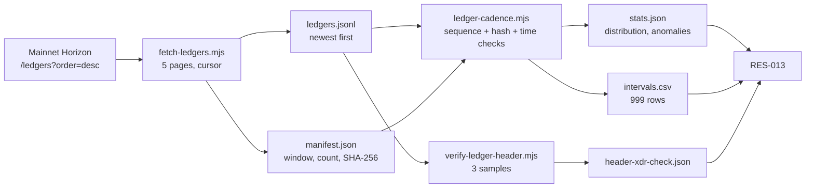

# RES-013 · Ledger Cadence and Finality on Pi

> **Claim types:** `FACT` — official, dated, linked, or measured here · `ANALYSIS` — this repository's
> reasoning, fallible · `PROPOSAL` — a suggestion with no official status.

---

## 1. Executive Summary

`FACT` — On 2026-10-25 this repository collected the **1,000 newest closed Mainnet ledgers** from
`https://api.mainnet.minepi.com/ledgers` (`S-60`). The sample covers sequences **29,405,159 → 29,406,158**
and close times **2026-10-25T20:11:50Z → 2026-10-25T21:35:05Z** — 4,995 seconds, or about 1.39 hours.
All **999** adjacent close intervals were exactly **5 seconds at ledger-header resolution**. Median, mean,
p95, p99, minimum and maximum were all 5 seconds; population standard deviation was 0. The full dataset,
manifest, statistics, interval CSV, and scripts are published in this repository (`M-06`).

`FACT` — The dataset passed every structural check applied to it: 1,000 expected ledger sequences, 1,000
present; 999/999 `prev_hash` values matched the preceding ledger's `hash`; all timestamps were valid,
strictly increasing, and on a 5-second boundary; the sum of intervals equalled the 4,995-second span. No
interval reached the exploratory slow-close threshold of 3× the median (15 seconds). No sequence gap, hash
break, duplicate close time, non-positive interval, or protocol-version change was observed.

`FACT` — For three sampled ledgers (first, middle, last), the `closeTime` field decoded directly from the
ledger header XDR equalled the Unix second in `closed_at`. For those samples, `closed_at` is the value the
ledger header carries, not an API-side display rounding (`M-06`, `header-xdr-check.json`).

`ANALYSIS` — The observed distribution is **degenerate**: one value, 5 seconds, repeated 999 times. The
usual tail questions — "how bad is the worst gap?" — have no tail to describe in this window. The reported
maximum of 5 seconds is therefore a statement about this sample, not a guarantee, a p99 over a day, or an
SLA. A longer window is required before any claim about typical or worst-case cadence.

`ANALYSIS` — **Ledger close is not transaction finality.** This study measures the interval between closed
ledgers. It does not measure how long a submitted transaction waits to be included, whether a closed ledger
is ever replaced, what confirmation depth an application should require, or when the Pi Platform API considers
a payment complete. A 5-second ledger cadence is an input to confirmation latency — not a finality policy.
[`OQ-006`](open-questions.md) remains open, and this document does not close it.

**What this document does not claim:** that Pi "always" closes a ledger every 5 seconds; that 5 seconds is
an SLA; that five seconds is a safe settlement time; or that the network cannot pause, fork, or reorganise.
None of those follows from one 1.39-hour sample.

---

## 2. Problem Statement

`ANALYSIS` — Most Pi payment flows contain a sentence like "wait for confirmation." That sentence hides at
least three different measurements:

| # | Measurement | Question it answers | Measured here? |
|---|---|---|---|
| 1 | **Ledger close interval** | How often does the chain close a ledger? | **Yes** — 999 intervals |
| 2 | **Transaction inclusion latency** | How long from submission until the transaction is in a closed ledger? | No — needs submission timestamps or mempool observation |
| 3 | **Application finality** | When may this app irreversibly deliver value? | No — depends on inclusion, validation, platform completion, and risk policy |

`ANALYSIS` — Conflating these three is not a pedantic error. It produces concrete failures:

- A merchant reads "5-second blocks" and delivers after five seconds, without checking that the payment is
  in a **closed** ledger, that the amount and destination match, or that `/complete` succeeded.
- An indexer treats a ledger close as a permanent checkpoint without recording what it would do if a
  competing history appeared.
- A monitoring system alerts on "more than 5 seconds between ledgers" and calls a normal network quiet
  period an outage, or misses a real outage because the API is serving an old ledger quickly.

`FACT` — Pi's public developer documentation says the blockchain is the only source of truth for exchanging
Pi (`S-04`), and the payment flow includes an explicit completion step (`S-03`). This repository's security
standard therefore requires on-chain verification of the transaction and a successful `/complete` before
delivery ([`RES-006`](security-and-trust.md) §5.2, [`PR-002`](../proposals/proposal-002-developer-standards.md)).
Neither document defines a required confirmation depth, and no official Pi guidance on one was found
([`SOURCES.md`](../SOURCES.md) §5, [`OQ-006`](open-questions.md)).

`ANALYSIS` — The missing baseline is the first gap this study can close cheaply. If "normal" close interval
is unknown, "the chain is lagging" cannot be tested. The study is deliberately narrow: measure the cadence,
validate the data, publish it, and stop before the result is stretched into a reliability claim.

---

## 3. Current State

### 3.1 Collection

`FACT` — The sample is the 1,000 newest closed ledgers returned by the Mainnet Horizon-compatible endpoint at
collection time. It is a **convenience sample of one contiguous window**, not a random sample and not the
full chain history.

| Property | Value | Evidence |
|---|---|---|
| Network | Mainnet | `M-06` |
| Endpoint | `https://api.mainnet.minepi.com/ledgers` | `S-60` |
| Query | `order=desc&limit=200`, cursor pagination via `_links.next.href` | `M-06` |
| Pages | 5 | `M-06` |
| Ledgers | 1,000 | `M-06` |
| Sequences | 29,405,159 → 29,406,158 | `M-06` |
| Chain window | 2026-10-25T20:11:50Z → 2026-10-25T21:35:05Z | `M-06` |
| Window length | 4,995 s = 1.388 h | `M-06` |
| Protocol version | 28 for all 1,000 ledgers | `M-06`, `M-04` |
| Dataset bytes | 341,677 | `M-06` |
| Dataset SHA-256 | `871e35ea3d6bad4dc08ac87d3c3e96166a67b28e93b611b11440eacbb40c52e5` | `M-06` |

`FACT` — The client clock read 2026-10-25T21:34:28.836Z at the start of collection and
2026-10-25T21:34:33.007Z at the end. It ran approximately **32 seconds behind** the newest ledger's
`closed_at`; the endpoint's HTTP `Date` headers also varied by tens of seconds between pages. Those clock
readings are recorded in the manifest and are **not** used to compute intervals. The chain timeline is
anchored to the `closed_at` values returned by the endpoint; the XDR check verifies that mapping for three
sample ledgers (`M-06`).

`ANALYSIS` — The clock skew is a property of the measurement environment, not of Pi. It matters only for
claims about "collection time" and "ledger age". It cannot change a displayed interval, because every
interval is a difference between two ledger timestamps.

### 3.2 Measured interval distribution

`FACT` — All 999 adjacent intervals are 5 seconds at ledger-header resolution. There is no spread to
summarise at that resolution.

| Statistic | Value |
|---|---|
| Ledgers | 1,000 |
| Adjacent intervals | 999 |
| Minimum | 5 s |
| 25th percentile | 5 s |
| Median | 5 s |
| Mean | 5 s |
| 75th percentile | 5 s |
| 90th percentile | 5 s |
| **95th percentile** | **5 s** |
| 99th percentile | 5 s |
| **Maximum** | **5 s** |
| Population standard deviation | 0 s |
| Interquartile range | 0 s |
| Median absolute deviation | 0 s |
| Distinct interval values | `{5}` |
| Mode | 5 s (999/999) |

`FACT` — Because every interval is tied at 5 seconds, the `max_gap` object in `stats.json` is the first pair
in sequence order, not a unique maximum. The same applies to `min_gap`. This is a tie-breaking artifact of
reporting one pair, not evidence that one particular pair was slower than the others (`M-06`).

`FACT` — The close times also align to a 5-second grid: every `closed_at` in the sample is an exact multiple
of five Unix seconds. The first interval is sequence 29,405,159 → 29,405,160 at 20:11:50Z → 20:11:55Z. The
last is 29,406,157 → 29,406,158 at 21:35:00Z → 21:35:05Z (`M-06`).

`FACT` — The sample contains 6,236 successful transactions, 12,971 failed transactions, and 12,547 operations
across the 1,000 ledgers. 293 ledgers (29.3%) contained neither a successful nor a failed transaction. The
mean was 19.207 transactions and 12.547 operations per ledger (`M-06`).

`ANALYSIS` — The transaction counts are **context, not a result**. A failed-transaction count is not an error
rate without the number of submitted transactions, which this dataset does not contain. The sample is also
too short to support any claim that cadence is independent of load; the cadence was constant while transaction
counts varied, but a single 1.39-hour window cannot separate "cadence is scheduled" from "load never crossed a
threshold that matters."

### 3.3 Integrity checks

`FACT` — The following checks were run against the committed data, not against a live response
(`M-06`, `stats.json`):

| Check | Result |
|---|---|
| Manifest's dataset SHA-256 matches the exact `ledgers.jsonl` bytes | Pass |
| Line count equals manifest `collected_count` | 1,000 = 1,000 |
| Ledger sequences contiguous across the range | Pass — 0 missing |
| Every `prev_hash` equals the preceding ledger's `hash` | Pass — 999/999 |
| All `closed_at` values parse as second-precision UTC ISO 8601 | Pass |
| `closed_at` strictly increasing | Pass |
| Sum of adjacent intervals equals full chain span | 4,995 s = 4,995 s |
| Any interval ≥ 3× median (slow-close rule) | 0 |
| Any interval ≥ 30 s | 0 |
| Protocol version constant | 28 for all |

`FACT` — The XDR cross-check fetched the oldest, middle, and newest ledgers again and compared them with the
committed records. For all three, the live `hash`, `prev_hash`, and `closed_at` matched the dataset, and the
`closeTime` decoded from the header (big-endian `uint64` at byte offset 68) equalled `closed_at` as a Unix
second. The check is reproducible with `scripts/verify-ledger-header.mjs`; its output is stored in
`header-xdr-check.json` (`M-06`).

`FACT` — A second, independent parse of `intervals.csv` and `ledgers.jsonl` returned the same minimum, median,
mean, p95, p99, maximum, distinct values, sequence count, sequence breaks, hash breaks, timestamp-order
violations, and 5-second-boundary violations. This is a self-check against a second implementation, not an
external review.

`ANALYSIS` — What these checks establish is **internal consistency and chain linkage for the fetched range**.
They do not establish that the endpoint served every ledger, that a different vantage point would see the
same history, or that the chain cannot reorganise. They make silent corruption of the published dataset
detectable; they do not turn the dataset into a consensus proof.

### 3.4 What this dataset cannot answer

| Question | Why not |
|---|---|
| How long does a submitted transaction wait for inclusion? | Collection starts from closed ledgers; no submission timestamps or mempool |
| What is the worst close gap over a day, a month, or an incident? | One 1.39-hour window, no incident coverage |
| Has a closed Pi ledger ever been replaced? | Only the canonical chain is visible; no competing histories observed |
| What confirmation depth is safe? | Not measured; `OQ-006` remains open |
| Do Mainnet and Testnet behave the same? | Testnet not sampled |
| Is the underlying consensus timer exactly 5.000 s? | Header close time has one-second resolution; sub-second jitter is invisible |
| Is 5 seconds a protocol rule or a scheduling policy? | No protocol specification was tested; this is an observation |
| Does cadence change under load? | Load varied, but the window is too short to isolate a relationship |

`ANALYSIS` — The second-resolution limitation deserves emphasis. The ledger header stores `closeTime` as
whole seconds. If the real close times were 50.2 s, 55.3 s, and 60.4 s past a minute, the header would show
50, 55, and 60 — also "exactly 5 seconds apart." The observation is therefore precise at the resolution the
ledger exposes, not at millisecond resolution. The correct sentence is: **the header close-time seconds
advanced by exactly 5 on every adjacent pair in this window.** The stronger sentence — "Pi's consensus
timer fired exactly every 5.000 seconds" — is not supported.

`ANALYSIS` — What would change this conclusion:

- Re-fetching the same sequence range returns a different `hash` or `closed_at` for any sampled ledger.
- A longer window contains an adjacent interval greater than 5 seconds, or a sequence gap whose surrounding
  intervals do not sum to the elapsed time.
- A ledger-header `closeTime` disagrees with the `closed_at` served by the API.
- A competing history is observed, so the canonical-chain assumption fails.
- The committed dataset cannot be re-parsed to reproduce the published statistics.

None of these was observed in this study. They are listed so that a future test can fail, rather than only
confirm.

---

## 4. Proposed Solution

This is a measurement study, not a network redesign. The "solution" is a disciplined way to use the result.

### 4.1 Keep the metrics separate

`PROPOSAL` — Any Pi monitoring or payment design should name which of these it is measuring, and should not
substitute one for another:

| Metric | Definition | What it can support | What it cannot support |
|---|---|---|---|
| **Close interval** | `closed_at[i] − closed_at[i−1]` for adjacent sequences | A descriptive cadence baseline | User-perceived confirmation time |
| **Ledger lag** | `probe_time − latest_ledger.closed_at` | Whether an endpoint is serving an old head | Whether a specific payment is included |
| **Confirmation latency** | `containing_ledger.closed_at − submission_time` | Payment UX and timeout design | Irreversibility |
| **Finality depth** | Number of ledgers (or platform state) an app requires before delivery | Risk policy | A guarantee the network cannot reorganise |

`ANALYSIS` — The first row is what this study measured. The second is defined in [`PR-001`](../proposals/proposal-001-rpc-monitoring.md).
The third and fourth require data this study does not have. A monitoring system that reports only the first
row is measuring the chain's heartbeat, not its service to a payment.

### 4.2 Use the number as a baseline, not a threshold

`PROPOSAL` — Treat "5 seconds" as the **observed modal interval for this window**, and record the window with
it. Do not publish "Pi closes every 5 seconds" as a general fact, and do not configure an alert at "more than
5 seconds" without a longer sample.

`PROPOSAL` — A cadence monitor should alert on **structural** failures first:

1. Sequence number gap or duplicate in the observed range.
2. `prev_hash` no longer matching the previous ledger's `hash`.
3. A close time that is not strictly increasing.
4. Ledger lag rising while the endpoint still answers quickly.
5. A protocol-version change unaccompanied by a recorded upgrade.

Only after those should it alert on interval length, and the threshold should be derived from a published
rolling baseline — not from a single 5-second observation.

### 4.3 Publish the raw window, then extend it

`PROPOSAL` — Re-run the same scripts on a schedule, keep each window immutable, and publish the manifest and
SHA-256 with it. A useful next dataset is **7 consecutive days**, or a set of daily windows that includes at
least one protocol upgrade and one reported incident. Until then, the honest description of the baseline is
"one window", not "Pi's cadence".

`ANALYSIS` — The degenerate distribution also breaks naive percentile anomaly detection. With median 5 s,
the 3× rule sets a 15-second threshold; in this window nothing crosses it. A longer sample is needed before
that rule can distinguish "normal jitter" from "a stalled chain".

---

## 5. Architecture

### 5.1 Pipeline



### 5.2 Files and fields

| Artifact | Contents | Why it exists |
|---|---|---|
| `data/ledger-cadence-2026-10-25/ledgers.jsonl` | 1,000 records, newest first | Raw evidence; every statistic is derivable from it |
| `manifest.json` | Endpoint, query, collection window, count, bounds, SHA-256, clock note | Makes the dataset identifiable and tamper-evident |
| `stats.json` | All computed statistics and validation results | One machine-readable result file |
| `intervals.csv` | One row per adjacent pair | Lets a reader recompute without the script |
| `header-xdr-check.json` | Three live-vs-dataset checks with decoded header close times | Tests the meaning of `closed_at` |
| `scripts/fetch-ledgers.mjs` | Read-only collector | Reproduces the window |
| `scripts/ledger-cadence.mjs` | Validator and statistician | Reproduces the numbers |
| `scripts/verify-ledger-header.mjs` | XDR close-time checker | Reproduces the `closed_at` check |

Each ledger record in `ledgers.jsonl` has:

| Field | Meaning |
|---|---|
| `sequence` | Ledger sequence number |
| `closed_at` | Ledger close time, second-precision UTC ISO 8601 |
| `protocol_version` | Protocol version reported for the ledger |
| `successful_transaction_count` | Successful transactions included |
| `failed_transaction_count` | Failed transactions included |
| `operation_count` | Operations in the ledger |
| `tx_set_operation_count` | Operations in the transaction set |
| `hash` | Ledger hash |
| `prev_hash` | Previous ledger hash |

### 5.3 Definitions

```text
interval_i = closed_at_i − closed_at_(i−1)
             for sequence_i = sequence_(i−1) + 1, sorted ascending

median      = middle value; average of the two middle values when n is even
percentile  = nearest-rank: sorted[ceil(p × n) − 1], clamped to [1, n]
stddev      = population standard deviation (divide by n)
slow close  = interval ≥ 3 × median          (exploratory rule, not an SLA threshold)
```

`ANALYSIS` — The choice of nearest-rank percentiles is deliberate: with a discrete, integer-valued
distribution, interpolated percentiles can produce values that never occurred. Nearest-rank always returns an
observed interval. With all values equal to 5, the choice makes no difference here, but it matters for a
future window with jitter.

---

## 6. Benefits and Risks

### 6.1 Benefits

| Benefit | Mechanism |
|---|---|
| A dated baseline exists | The window, count, and statistics are published with a hash |
| "Confirmed" can be discussed precisely | The document separates close interval, ledger lag, inclusion latency, and finality depth |
| Silent data corruption is detectable | SHA-256, line count, sequence check, hash-link check, interval-sum check |
| The result is reproducible | Three scripts; raw JSONL and CSV; no private credentials |
| `PR-001` gets a reference point | The probe can report lag against a measured cadence, not folklore |
| The absence of anomalies is itself recorded | A future window can be compared with this one |

### 6.2 Risks

| Risk | Severity | Mitigation |
|---|---|---|
| **Overgeneralisation from one window** | High | Label every number as this sample; no SLA; schedule a longer run |
| **"Maximum gap = 5 s" read as a guarantee** | High | State that all values are tied and that no tail was observed |
| **Confusing close interval with finality** | High | The four-way metric separation in §4.1; `OQ-006` stays open |
| **Second-resolution truncation hides sub-second jitter** | Medium | State the limitation; do not claim exact 5.000 s |
| **Closed-ledger survivorship hides reorgs** | Medium | Say only what was observed; no reorg claim |
| **Clock skew corrupts collection-time claims** | Medium | Anchor intervals to `closed_at`; record the client lag and API Date inconsistency |
| **Transaction counts misread as error rates** | Medium | State that submissions are not in the dataset |
| **Dataset goes stale** | Medium | `evidence_cutoff`; re-run before citing as current |
| **Single vantage point** | Low–Medium | Cadence comes from chain records, but completeness of the fetch is vantage-dependent |
| **API or field format changes** | Low | Manifest schema and scripts fail loudly rather than guessing |

`ANALYSIS` — The highest-severity risk is not a data error. It is the sentence a reader may write after
skimming: **"Pi confirms transactions in 5 seconds."** This study does not support that sentence. It supports:
"in this 1,000-ledger window, consecutive ledgers closed 5 seconds apart at the resolution exposed by the
ledger header."

---

## 7. Implementation Roadmap

| Step | Work | Status | Effort | Prerequisite |
|---|---|---|---|---|
| 1 | Freeze dataset schema and selection rule | **done** 2026-10-25 | 1 day | This document |
| 2 | Collect 1,000 consecutive Mainnet ledgers | **done** 2026-10-25 | minutes | Step 1 |
| 3 | Validate sequence, hash chain, timestamps; compute distribution | **done** 2026-10-25 | 1 day | Step 2 |
| 4 | Cross-check `closed_at` against header XDR | **done** 2026-10-25 | hours | Step 2 |
| 5 | Publish dataset, manifest, scripts, and this document | **done** 2026-10-25 | 1 day | Steps 3–4 |
| 6 | Independent re-run by someone other than the author | **planned** | hours | Step 5 |
| 7 | Extend to 7 days or a set of daily windows | **planned** | 1 week | Step 6 |
| 8 | Repeat on Testnet and from a second vantage point | **planned** | days | Step 7 |
| 9 | Feed a rolling cadence/lag baseline into `PR-001` | **planned** | days | Steps 7–8 |

`ANALYSIS` — Step 6 is the gate that matters. Until another person can run the three scripts and obtain the
same statistics from the committed data, this is a self-checked measurement, not an independently verified
one. Step 7 is the first step that can say anything about a *distribution* rather than a single window.

---

## 8. Open Questions

1. Is the 5-second cadence stable across 24 hours, 7 days, protocol upgrades, and incidents, or is this
   window unusually quiet?
2. Has any Pi ledger ever closed more than 5 seconds after its predecessor? This window contains no such
   case. A longer sample, or an incident report with timestamps, would answer it.
3. What is the distribution of **transaction inclusion latency** for transactions submitted to Pi? This
   requires submission timestamps or mempool observation, neither of which is in this dataset.
4. Has a closed Pi ledger ever been replaced by a competing history? This dataset observes only one canonical
   chain. No reorg was observed; that is not evidence that reorgs cannot occur.
5. What confirmation depth should an application require before delivering value? (`OQ-006`) This study
   provides an input, not an answer.
6. Do Mainnet and Testnet share the same cadence? Testnet was not sampled.
7. Why were failed transactions roughly twice as numerous as successful ones in this window? Is that normal,
   and what is the denominator of submitted transactions?
8. Does the 5-second grid reflect a protocol-level schedule, a node configuration, or merely the way the
   header close time is constructed? A protocol specification or implementation reference would answer it.

---

## 9. References

| # | Source | Type | Date |
|---|---|---|---|
| `S-60` | Mainnet Horizon endpoint | Official | retrieved 2026-10-25 |
| `S-03` | Accept a payment (U2A), including completion step | Official | retrieved 2026-10-25 |
| `S-04` | Advanced payments (A2U); "blockchain is the only source of truth" | Official | retrieved 2026-10-25 |
| `M-04` | Mainnet/Testnet passphrases; protocol 28 on both | Measurement | 2026-10-25 |
| `M-06` | 1,000 Mainnet ledgers; 999/999 intervals = 5 s; dataset and XDR check | Measurement | 2026-10-25 |
| [`RES-002`](rpc-infrastructure.md) | RPC infrastructure, ledger-lag definitions | Research | 2026-10-25 |
| [`RES-006`](security-and-trust.md) | Payment verification order and controls | Research | 2026-10-25 |
| [`RES-012`](open-questions.md) | `OQ-006` on confirmation depth | Research | 2026-10-25 |
| [`PR-001`](../proposals/proposal-001-rpc-monitoring.md) | Probe definitions and ledger lag | Proposal | 2026-10-25 |
| [`PR-002`](../proposals/proposal-002-developer-standards.md) | Payment conformance standard | Proposal | 2026-10-25 |

**Artifacts**

| Artifact | Path |
|---|---|
| Dataset | [`data/ledger-cadence-2026-10-25/ledgers.jsonl`](../data/ledger-cadence-2026-10-25/ledgers.jsonl) |
| Manifest | [`manifest.json`](../data/ledger-cadence-2026-10-25/manifest.json) |
| Statistics | [`stats.json`](../data/ledger-cadence-2026-10-25/stats.json) |
| Intervals | [`intervals.csv`](../data/ledger-cadence-2026-10-25/intervals.csv) |
| XDR check | [`header-xdr-check.json`](../data/ledger-cadence-2026-10-25/header-xdr-check.json) |
| Collector | [`scripts/fetch-ledgers.mjs`](../scripts/fetch-ledgers.mjs) |
| Analyser | [`scripts/ledger-cadence.mjs`](../scripts/ledger-cadence.mjs) |
| XDR verifier | [`scripts/verify-ledger-header.mjs`](../scripts/verify-ledger-header.mjs) |

**Reproduce**

```bash
# Fresh replication: write to a new, ignored directory; never overwrite the committed evidence.
node scripts/fetch-ledgers.mjs --network mainnet --count 1000 --out data/ledger-cadence-replication
node scripts/ledger-cadence.mjs --dir data/ledger-cadence-replication

# Re-check the committed sample against the live ledger headers.
node scripts/verify-ledger-header.mjs --dir data/ledger-cadence-2026-10-25 \
  --out data/header-xdr-check-replication.json
```

`ANALYSIS` — A re-run will collect a different 1,000-ledger window, so its hashes and bounds will differ by
design. Compare the statistics, not the file hash. The committed window is the evidence for the numbers
above; a fresh run is a replication, not an overwrite. The example writes to an ignored path so the committed
dataset is left untouched.

---

**Related:** [`RES-002`](rpc-infrastructure.md) · [`RES-006`](security-and-trust.md) ·
[`RES-012`](open-questions.md) · [`PR-001`](../proposals/proposal-001-rpc-monitoring.md) ·
[`SOURCES.md`](../SOURCES.md) §3 `M-06`
