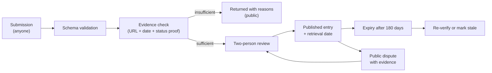

# RES-004 · Pi Ecosystem Infrastructure Map

> **Claim types:** `FACT` — official, dated, linked · `ANALYSIS` — this repository's reasoning, fallible ·
> `PROPOSAL` — a suggestion with no official status.

---

## 1. Executive Summary

Most "Pi ecosystem" lists are app directories: a logo, a category, a link. They answer *"what can I use?"* and
fail to answer *"what can I build on?"*

This document is a different artefact: a **classification of infrastructure layers**, with a status vocabulary
that distinguishes what is live from what is announced, and an evidence rule for every entry. It deliberately
contains few named third-party apps — not because they do not exist, but because this repository cannot verify
them at the standard it applies to its own claims.

`ANALYSIS` — An honest map with a small number of verified entries is more useful than a large map of
unverified ones, because the gaps become visible and therefore actionable. The map's value is in its
**inclusion criteria**, not its length.

---

## 2. Problem Statement

| Problem with existing lists | Consequence |
|---|---|
| "Active" has no definition | A dead app and a thriving app look identical |
| Testnet and Mainnet are mixed | Users mistake a demo for a product |
| RFCs appear as features | Readers plan around things that may never ship |
| No evidence per entry | A listing cannot be audited or corrected |
| Categories mix tools with apps | Builders cannot find a primitive; users cannot find a product |
| Rankings are unexplained | Discovery becomes pay-to-play or popularity-by-default |

`ANALYSIS` — The root cause is that a directory conflates three different objects: a **primitive** (something
you build with), a **product** (something you use), and a **proposal** (something that might exist). Mixing
them produces a list that is comprehensive and useless.

---

## 3. Current State

### 3.1 Official surfaces that already provide discovery

| Surface | What it lists | Evidence model | Source |
|---|---|---|---|
| Pi Browser "PiApps" tab | Apps, with staking-influenced ranking | Platform-curated | `S-27` |
| Ecosystem Directory staking | App staking and ranking boost | On-platform | `S-27` |
| KYB verified businesses | Businesses verified by Pi | Verification by Pi | `S-37` |
| PiOS registry | Community apps and libraries under the PiOS licence | Self-registered | `S-13` |
| SoloHost featured apps | Self-hosted apps (Hermes, OpenClaw, mcp-atlassian) | Editorially featured | `S-29`, `S-31` |
| Launchpad | Ecosystem tokens | Testnet only | `S-24` |
| Pi Network Ventures | Funded/partnered projects | Programme | `S-38` |

> **This repository does not duplicate those lists.** Duplicating a curated list creates a stale copy that
> looks authoritative. The map below classifies *layers*, and points at the authority for membership.

### 3.2 The layers

| Layer | Definition | Examples of primitives (not apps) |
|---|---|---|
| **L0 — Ledger** | Consensus, accounts, assets | Protocol 28; native Pi asset |
| **L1 — Chain access** | Reading and submitting transactions | Horizon endpoints; official explorer |
| **L2 — Platform** | Identity, payments, directory, staking | Platform API; KYC; staking data API |
| **L3 — Runtime** | Where an app runs and what it can touch | Pi Browser; SDK; local storage; `Pi.shareFile` |
| **L4 — Authoring** | How an app is created | Docs; sandbox; App Studio; PiOS; demo app |
| **L5 — Node & compute** | Where user hardware participates | Pi Node; SoloHost; compute coordinator (PoC) |
| **L6 — Capital & markets** | Tokens, liquidity, funding | PiRC1; Launchpad (Testnet); DEX (Testnet); Ventures |
| **L7 — Trust & verification** | How claims are checked | KYB list; app verification (criteria unpublished) |

`ANALYSIS` — L7 is the layer that barely exists. Every other layer has at least one primitive; "how do I know
this is legitimate" has a KYB list and a badge whose criteria are not public. That is the single largest gap in
the map, and it is the subject of [`PR-003`](../proposals/proposal-003-ecosystem-directory.md).

---

## 4. Proposed Solution

`PROPOSAL` — A map with a strict status vocabulary, an evidence requirement per entry, and a dispute path.
Four rules do all the work.

### 4.1 Status vocabulary

| Status | Definition | Evidence required |
|---|---|---|
| `live-mainnet` | Usable by the public on Mainnet today | A public URL + a dated observation of the working flow |
| `live-testnet` | Usable on Testnet only | Public URL + explicit official statement that it is Testnet |
| `beta-gated` | Live but restricted (whitelist, invitation, region) | Official statement of the gate |
| `rfc` | A published proposal, not live | Link to the RFC and its date |
| `poc` | Demonstrated, not operated as a service | Official statement describing a test |
| `announced` | Said to be coming, with no artefact | The exact announcement + date |
| `deprecated` | Superseded or withdrawn | The notice or a documented absence |
| `unverified` | Widely claimed, not confirmable | None — and it must say so |

### 4.2 The four rules

| # | Rule | Why |
|---|---|---|
| R1 | **One status per entry, and the weakest applicable wins** | Optimism inflates maps |
| R2 | **Every entry cites a URL and a retrieval date** | Otherwise it cannot be corrected |
| R3 | **A proposal is never listed as a primitive** | Readers plan around RFCs otherwise |
| R4 | **Disputes are public and dated** | Prevents quiet delisting of inconvenient entries |

### 4.3 Entry schema

```json
{
  "schema": "pi-ecosystem-entry/1",
  "name": "Official BlockExplorer",
  "layer": "L1",
  "kind": "primitive",
  "status": "live-mainnet",
  "operator": "Pi Network",
  "url": "https://blockexplorer.minepi.com/",
  "evidence": [{ "url": "…", "retrieved": "2026-10-25", "supports": "public UI" }],
  "gates": [],
  "notes": "No documented public data API found on 2026-10-25."
}
```

### 4.4 Starter map (verified entries only)

| Layer | Entry | Kind | Status | Source |
|---|---|---|---|---|
| L0 | Stellar-derived L1, protocol 28 | primitive | `live-mainnet` | `M-01` |
| L1 | Horizon Mainnet | primitive | `live-mainnet` | `S-60` |
| L1 | Horizon Testnet | primitive | `live-testnet` | `S-61` |
| L1 | Official BlockExplorer | product | `live-mainnet` | `S-36` |
| L2 | Platform API (payments, auth) | primitive | `live-mainnet` | `S-06` |
| L2 | Staking Data API | primitive | `beta-gated` (whitelist) | `S-32` |
| L2 | Ecosystem Directory staking | primitive | `live-mainnet` | `S-27` |
| L3 | Pi Browser | runtime | `live-mainnet` | `S-11` |
| L3 | `@pinetwork/pi-sdk-js@2.0.0` | primitive | `live-mainnet` | `S-09` |
| L3 | Local storage | primitive | `beta-gated` (whitelist) | `S-32` |
| L3 | `Pi.shareFile` | primitive | `live-mainnet` | `S-32` |
| L4 | `docs.minepi.com` | primitive | `live-mainnet` | `S-01` |
| L4 | App Studio | product | `live-mainnet` | `S-30` |
| L4 | PiOS + registry | primitive | `live-mainnet` | `S-13` |
| L4 | Demo app (`demo.pi`) | primitive | `live-mainnet` | `S-11` |
| L5 | Pi Node 0.6.x | product | `beta-gated` (Mainnet transition by invitation; anyone may technically run a node) | `S-29`, `S-20` |
| L5 | SoloHost | runtime | `beta-gated` (beta) | `S-31` |
| L5 | Distributed compute | capability | `poc` | `S-29` |
| L6 | PiRC1 Launchpad | mechanism | `live-testnet` | `S-24` |
| L6 | Pi DEX | mechanism | `live-testnet` | `S-24` |
| L6 | Ecosystem-token design (PiRC1) | mechanism | `rfc` | `S-23` |
| L6 | Pi Network Ventures | programme | `live-mainnet` | `S-38` |
| L7 | KYB verified businesses | product | `live-mainnet` | `S-37` |
| L7 | Smart-contract audit (subscription) | process | `unverified` | `S-26` |

That table is short on purpose. Every row can be checked in one click.

---

## 5. Architecture

### 5.1 Curation pipeline



### 5.2 Governance invariants

| # | Invariant | Reason |
|---|---|---|
| G1 | Submission is free and needs no account on any platform | Access |
| G2 | Rejections are published with reasons | Trust |
| G3 | Status changes are dated and diffable | Auditability |
| G4 | No entry may be removed without a recorded reason | Prevents quiet pressure |
| G5 | Maintainers may not accept payment for inclusion or ranking | Independence |
| G6 | Ranking, if any, is derived from published signals only | No pay-to-play |

---

## 6. Benefits and Risks

### 6.1 Benefits

| Benefit | Who |
|---|---|
| "What exists, and how live is it?" answered in one table | Builders |
| Testnet demos no longer mistaken for products | Users |
| A correction path for wrong listings | Everyone |
| Visible gaps (notably L7) that attract work | Contributors |
| A schema others can reuse | Directory builders |

### 6.2 Risks

| Risk | Severity | Mitigation |
|---|---|---|
| **Staleness** — entries rot | High | 180-day expiry; explicit `stale` state |
| **Gatekeeping** — maintainers become de facto approvers | High | G2, G4, G5; multiple reviewers |
| **Defamation** via negative status | Medium | Status vocabulary is factual, not evaluative |
| **Completeness claims** | Medium | State coverage explicitly: "verified entries, not all entries" |
| **Pressure from projects** | Medium | Public dispute process; no private delisting |
| **Duplication** of official lists | Medium | Link to the authority; never copy membership wholesale |

---

## 7. Implementation Roadmap

| Phase | Deliverable | Exit criterion |
|---|---|---|
| 0 | Status vocabulary + schema published | This document |
| 1 | §4.4 starter map, machine-readable | A validator accepts every row |
| 2 | Submission + rejection records public | Three rejections documented with reasons |
| 3 | Expiry automation | A stale entry is visibly marked without human action |
| 4 | Layer view rendered (any UI) | A builder finds a primitive in under a minute |
| 5 | Cross-link with [`PR-003`](../proposals/proposal-003-ecosystem-directory.md) schema | One schema, two consumers |

---

## 8. Open Questions

1. What are the criteria for "verified" in the Pi app directory? (`OQ-004`)
2. Does the KYB list's verification scope extend to app behaviour, or only to business identity? (`OQ-020`)
3. Is there an official statement on how directory ranking is calculated beyond staking? (`S-27`)
4. Should this map include third-party apps at all, or remain infrastructure-only?
5. How should a project that is `announced` for two years be treated?
6. Who funds the maintenance of a verified map, and does funding compromise G5?

See [`RES-012`](open-questions.md).

---

## 9. References

| # | Source | Type | Date |
|---|---|---|---|
| `S-01` | Developer docs | Official | 2026-09-04 |
| `S-06` | Platform API | Official | pinned 2024-08-28 |
| `S-09` | SDK 2.0.0 | Official | 2026-03-19 |
| `S-11` | Developer landing page | Official | retrieved 2026-10-25 |
| `S-13` | PiOS registry | Official | retrieved 2026-10-25 |
| `S-20` | Open Network launch; node Mainnet transition by invitation | Official | 2025-02-20 |
| `S-23` | Ecosystem-token design for Mainnet | Official | 2026-02-20 |
| `S-24` | Launchpad on Testnet; DEX on Testnet | Official | 2026-03-19 |
| `S-26` | Subscription contract + audit status | Official | 2026-04-17 |
| `S-27` | Directory staking and ranking | Official | 2026-06-18 |
| `S-29` | Pi Node 0.6.2 | Official | 2026-08-14 |
| `S-30` | App Studio pricing | Official | 2026-08-17 |
| `S-31` | SoloHost beta | Official | 2026-08-27 |
| `S-32` | Whitelisted capabilities | Official | 2026-09-04 |
| `S-36` | Official explorer | Official | retrieved 2026-10-25 |
| `S-37` | KYB list | Official | retrieved 2026-10-25 |
| `S-38` | Pi Network Ventures | Official | retrieved 2026-10-25 |
| `M-01` | Protocol 28 observed | Measurement | 2026-10-18 |

---

**Related:** [`RES-001`](pi-network-future.md) · [`RES-003`](launchpad-opportunities.md) ·
[`PR-003`](../proposals/proposal-003-ecosystem-directory.md) · [`SOURCES.md`](../SOURCES.md) §5
