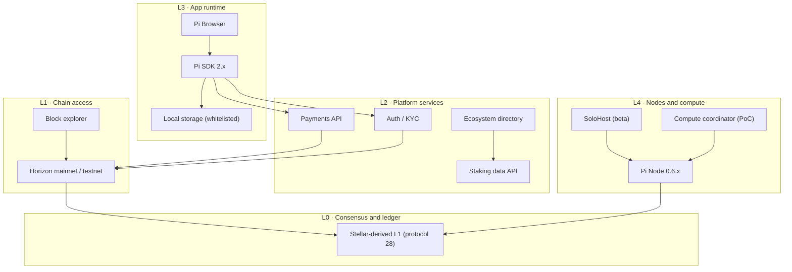

# RES-001 · The Future of Pi Network Infrastructure

> **Claim types:** `FACT` — official, dated, linked · `ANALYSIS` — this repository's reasoning, fallible ·
> `PROPOSAL` — a suggestion with no official status.

---

## 1. Executive Summary

Pi in 2026 is no longer a single product. It is a stack: a Stellar-derived Layer 1, a chain-access layer
(Horizon-compatible APIs), a platform layer (auth, payments, KYC, directory), an app runtime (Pi Browser),
and — new since mid-2026 — a **node and compute layer** (Pi Node, SoloHost, a distributed-compute
coordinator).

Each layer exists. What does not yet exist, publicly, is the thing that makes a stack usable by people who
do not work inside it: **published contracts between the layers**. The missing artefacts are unglamorous and
specific — a status page, an OpenAPI document, an incident log, a contract registry, an app manifest schema,
and a compute job protocol.

`ANALYSIS` — The next meaningful improvement to Pi infrastructure is therefore unlikely to be a new
consensus feature. It is more likely to be **legibility**: making what already exists measurable, documented,
and predictable from the outside.

This document maps the stack, separates what exists from what is announced from what is proposed, and lists
the six artefacts that would close most of the gap.

---

## 2. Problem Statement

A developer arriving at Pi today can build an app. That is a genuine achievement and is not the problem.

The problem is everything *around* the happy path:

| Situation | What a developer can currently rely on | Consequence |
|---|---|---|
| "Is the chain API slow, or is my code slow?" | Nothing published | Debugging by anecdote |
| "What are the rate limits?" | Not published | Either over-engineering or surprise throttling |
| "Did the platform have an incident yesterday?" | Social media, if anything | No way to correlate a bug with an outage |
| "Which contract address is the audited subscription contract?" | A GitHub repository | No canonical registry to check an address against |
| "Is this app verified, and by whom?" | A directory listing | Verification claims are hard to audit |
| "What does this compute job actually cost?" | Nothing published | Cannot plan |

None of these are exotic. Each is a normal expectation in a platform ecosystem, and each is a **documentation
and instrumentation** problem rather than a protocol problem.

`ANALYSIS` — This is the central claim of this document: for Pi's next phase, **the marginal return on
documentation and measurement is higher than the marginal return on new chain features.** Chain features
arrive on their own cadence; legibility does not arrive unless someone builds it.

---

## 3. Current State

### 3.1 What exists (official, dated)

| Layer | Component | Evidence | Date |
|---|---|---|---|
| L0 | Stellar-derived Layer 1; Mainnet `networkPassphrase = "Pi Network"` · Testnet `"Pi Testnet"`; same `@stellar/stellar-sdk` | `S-05`, `M-04` | documented; measured 2026-10-25 |
| L0 | Mainnet `protocol_version = 28` observable | `M-01` | measured 2026-10-18 |
| L1 | Horizon-compatible endpoints for Mainnet and Testnet | `S-60`, `S-61` | retrieved 2026-10-25 |
| L1 | Official block explorer | `S-36` | retrieved 2026-10-25 |
| L2 | Platform API at `api.minepi.com/v2`; `PaymentDTO` published | `S-06` | pinned 2024-08-28 |
| L2 | Three-phase payment flow (approve → transact → complete) | `S-07`, `S-08` | retrieved 2026-10-25 |
| L2 | App-specific staking data API (**whitelisted**) | `S-32` | 2026-09-04 |
| L2 | Ecosystem directory with staking-based ranking | `S-27` | 2026-06-18 |
| L3 | SDK `@pinetwork/pi-sdk-js@2.0.0`; Pi Browser required for auth/payments | `S-09`, `S-02` | published 2026-03-19 |
| L3 | Local storage for **whitelisted** apps; `Pi.shareFile` | `S-32` | 2026-09-04 |
| L3 | Consolidated developer docs at `docs.minepi.com` | `S-01`, `S-32` | 2026-09-04 |
| L4 | Pi Node 0.6.2: UPnP, port checker, SoloHost app states | `S-29` | 2026-08-14 |
| L4 | SoloHost: permissionless self-hosted app framework, **beta** | `S-28`, `S-31` | 2026-08-27 |
| L4 | Distributed-compute test via SoloHost, 5 volunteer Nodes | `S-29` | 2026-08-14 |
| L4 | `420,000+` Node runners (official claim) | `S-31` | 2026-08-27 |

### 3.2 What is announced but not live

| Component | Status at evidence cut-off | Evidence |
|---|---|---|
| Pi Launchpad | **Testnet only**; Mainnet version pending | `S-24` |
| Subscription smart contract | **Testnet**; external audit in progress; Mainnet rollout pending | `S-26`, `S-55` |
| Pi DEX | **Testnet** | `S-24` |
| Ecosystem tokens on Mainnet | Released 2026-02-20 (design + tokens); Launchpad path to issue them is still Testnet | `S-23`, `S-24` |
| Distributed compute | PoC complete with 5 Nodes; no published production service | `S-29`, `S-34` |
| PiRC1 / PiRC2 | **Requests for Comment** — open to change | `S-52`, `S-53`, `S-54` |

### 3.3 What is not published

| Missing artefact | Impact | Confidence |
|---|---|---|
| Rate limits for `S-60` / `S-61` | Clients cannot be sized correctly | `FACT` — none found in official docs, 2026-10-25 |
| Availability target / SLA | Any reliability claim is unverifiable | `FACT` — none found |
| Public status page and incident log | Outages are rediscovered socially each time | `FACT` — none found |
| OpenAPI description of the Platform API | No generated typed clients | `FACT` — the published artefact is prose + a `PaymentDTO` snippet |
| Contract registry with audit links | Addresses cannot be checked against a canonical list | `FACT` — none found |
| Compute job protocol / pricing | Economics of node compute are opaque | `FACT` — `S-29` says clients pay nodes in Pi, without terms |

> Two of these deserve care. First, **"not found" is not "does not exist"** — it may be behind a login, in a
> Discord, or in a document this repository has not seen. Second, a whitelist gate (`S-32`) is a **deliberate
> safety choice**, not necessarily a defect; the criticism here is that the *criteria* are unpublished, not
> that the gate exists.

---

## 4. Proposed Solution

`PROPOSAL` — Six artefacts, in dependency order. None requires a protocol change; each is adoptable by one
team.

| # | Artefact | What it is | Who could build it first |
|---|---|---|---|
| 1 | **Status + incident log** | Public, timestamped availability per endpoint, plus a durable incident record | Any operator with vantage points |
| 2 | **OpenAPI description** | Machine-readable schema of the documented Platform API surface | Platform team, or the community *from* public docs |
| 3 | **Chain access contract** | Published limits, pagination semantics, retention, deprecation policy | Chain-access operator |
| 4 | **Contract registry** | Address → source → audit → status, verifiable | Contract authors |
| 5 | **App manifest** (`pi-app.json`) | Machine-readable app identity, permissions, disclosure | App developers |
| 6 | **Compute job protocol** | Task envelope, verification tier, payment terms | SoloHost / compute operators |

Artefacts 1 and 3 are specified in [`PR-001`](../proposals/proposal-001-rpc-monitoring.md).
Artefacts 2 and 5 are specified in [`PR-002`](../proposals/proposal-002-developer-standards.md).
Artefact 4 is discussed in [`RES-011`](smart-contract-ecosystem.md).
Artefact 6 is specified in [`PR-005`](../proposals/proposal-005-decentralized-services.md).

### 4.1 The principle behind all six

> **Publish the contract, not just the implementation.**

An implementation can change silently. A published contract — a schema, a limit, a version number, an incident
log — creates an obligation that can be checked. Most of the trust problems in this document dissolve when the
obligation is written down, because a violation becomes visible rather than debatable.

---

## 5. Architecture

### 5.1 The stack as it is

`ANALYSIS` — Read the diagram as a **trust gradient**, not an architecture diagram. Going down, verification
gets cheaper (anyone can read the ledger). Going up, verification requires the platform's cooperation. Most
of the missing artefacts are in L2–L4, precisely the layers where an outsider cannot check anything alone —
which is why they matter.

### 5.2 The stack if the six artefacts existed

| Layer | Before | After |
|---|---|---|
| L0 | Readable ledger | Unchanged — already verifiable |
| L1 | Documented endpoints, unpublished limits | Endpoint contract + status page + incident log |
| L2 | Prose API docs | OpenAPI schema + versioning + deprecation policy |
| L3 | SDK + per-app capabilities | App manifest declaring permissions and disclosures |
| L4 | Beta framework, PoC compute | Job protocol with verification tiers and payment terms |

### 5.3 Design constraints

| Constraint | Consequence for any proposal |
|---|---|
| Pi Browser is required for SDK auth/payments (`S-02`) | Web-only apps cannot fully participate; any standard must define behaviour outside the browser |
| Capabilities can be whitelisted (`S-32`) | Standards must degrade gracefully when a capability is unavailable |
| Smart contracts are Testnet-first (`S-26`) | Any contract-dependent design needs a non-contract fallback |
| Node participation ≠ consensus authority | Compute proposals must not assume nodes validate the chain; see [`RES-007`](decentralized-compute.md) |
| The platform backend is not the settlement layer (`S-04`) | Verification must read the chain, not only the API |

---

## 6. Benefits and Risks

### 6.1 Benefits

| Benefit | Who gains | How you would notice |
|---|---|---|
| Faster debugging | Every builder | Mean time to diagnose drops; fewer "is it down?" threads |
| Cheaper client design | Backend teams | Fewer defensive retries, predictable capacity |
| Auditable verification claims | Users | A listing can be checked, not trusted |
| Safer contracts | Anyone touching value | Address → source → audit is one lookup |
| Compute economics become plannable | Node runners, clients | A price and a verification tier exist before the job |
| Lower onboarding cost | New developers | One schema instead of several prose pages |

### 6.2 Risks

| Risk | Severity | Mitigation |
|---|---|---|
| **Standards fragmentation** — three competing "Pi app manifests" | Medium | Publish one, wait for adoption, accept forks openly rather than pretending unity |
| **Measurement theatre** — a dashboard that measures the wrong thing | High | Publish raw data + methodology; let others recompute ([`PR-001`](../proposals/proposal-001-rpc-monitoring.md)) |
| **False authority** — readers treat this repo as official | High | Permanent `PROPOSAL` labelling; [`DISCLAIMER.md`](../DISCLAIMER.md) |
| **Publishing security-sensitive detail** | Medium–High | Describe classes of failure, never live exploits |
| **Over-fitting to 2026 Testnet behaviour** | High | Every `FACT` dated; RFC status stated wherever cited |
| **SLA by implication** — a community probe becomes "the" uptime claim | Medium | Probes state their vantage points and sample sizes; no extrapolation |
| **Compute proposals enabling abuse** | Medium | Eligibility, rate limits, and abuse reporting in [`PR-005`](../proposals/proposal-005-decentralized-services.md) |

---

## 7. Implementation Roadmap

| Phase | Deliverable | Depends on | Exit criterion |
|---|---|---|---|
| 0 (done) | This map, with dated evidence | — | Published |
| 1 (0–3 months) | `PR-001` probe spec + one independent implementation | Nothing | Two independent probe runs produce comparable data |
| 2 (1–4 months) | OpenAPI description derived from public docs | `PR-002` | A generated client compiles and works in sandbox |
| 3 (2–6 months) | Contract registry (manual, verifiable) | `RES-011` | Three contracts with source + audit links |
| 4 (3–9 months) | App manifest schema + validator | `PR-002` | One real app ships a manifest |
| 5 (6–12 months) | Compute job protocol draft | `PR-005`, `S-29` | A simulated job runs end-to-end with verification |

`ANALYSIS` — Phase 1 is the only phase that can start today with no cooperation from anyone. That is why it is
first. A plan whose first step requires permission is a wish.

---

## 8. Open Questions

1. **Are the Mainnet and Testnet Horizon endpoints operated with the same capacity and policy?** Affects
   whether testnet results predict production behaviour.
2. **What are the published rate limits, if any?** `OQ-001`.
3. **Is there an official incident history anywhere?** If not, the first probe becomes the de facto record.
4. **What distinguishes a "verified" app in the directory?** `OQ-004`.
5. **Do whitelisted capabilities have published criteria?** If yes, where; if no, is that intended?
6. **Is node participation permissioned, and does it affect compute eligibility?** `OQ-007`.
7. **How is a compute job's result verified today?** Five nodes completed tasks — but was the result checked?
8. **Does the platform API expose a stable, versioned deprecation policy?**

Full register: [`RES-012`](open-questions.md).

---

## 9. References

| # | Source | Type | Date |
|---|---|---|---|
| `S-01` | Pi developer docs | Official | consolidated 2026-09-04 |
| `S-02` | Wallet & SDK module | Official | retrieved 2026-10-25 |
| `S-04` | Advanced payments (A2U) | Official | retrieved 2026-10-25 |
| `S-06` | Platform API `PaymentDTO` | Official | pinned 2024-08-28 |
| `S-09` | `@pinetwork/pi-sdk-js@2.0.0` | Official | 2026-03-19 |
| `S-23` | Ecosystem tokens on Mainnet | Official | 2026-02-20 |
| `S-24` | Launchpad on Testnet | Official | 2026-03-19 |
| `S-26` | First smart contract (Testnet) | Official | 2026-04-17 |
| `S-27` | Ecosystem directory staking | Official | 2026-06-18 |
| `S-29` | Pi Node 0.6.2 + compute test | Official | 2026-08-14 |
| `S-31` | 420,000+ Node runners; SoloHost beta | Official | 2026-08-27 |
| `S-32` | Developer capabilities + docs | Official | 2026-09-04 |
| `S-36` | Official block explorer | Official | retrieved 2026-10-25 |
| `S-52` | PiRC process | Official (RFC) | retrieved 2026-10-25 |
| `M-01` | `protocol_version = 28` | Measurement | 2026-10-18 |

Full registry with pins: [`SOURCES.md`](../SOURCES.md).

---

**Related:** [`RES-002`](rpc-infrastructure.md) · [`RES-005`](developer-tools.md) ·
[`RES-007`](decentralized-compute.md) · [`RES-011`](smart-contract-ecosystem.md) ·
[`PR-001`](../proposals/proposal-001-rpc-monitoring.md) · [`PR-002`](../proposals/proposal-002-developer-standards.md)
