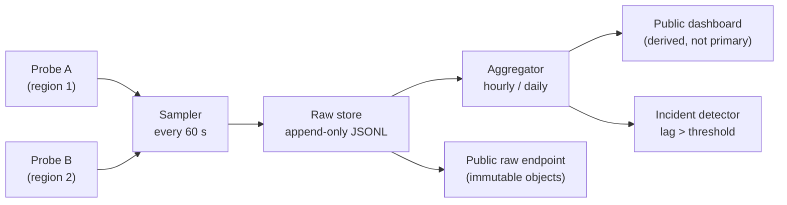

# RES-002 · RPC and Chain Access Infrastructure

> **Claim types:** `FACT` — official, dated, linked · `ANALYSIS` — this repository's reasoning, fallible ·
> `PROPOSAL` — a suggestion with no official status.

---

## 1. Executive Summary

Pi exposes chain access through Horizon-compatible endpoints on Mainnet and Testnet (`S-60`, `S-61`), and
platform services through a separate Platform API (`S-62`). The endpoints are documented. Their **operational
properties are not**: no published rate limits, no availability target, no status page, no incident log.

That gap has a specific consequence: every reliability conversation about Pi becomes anecdotal. One developer's
"the API is slow" cannot be compared with another's, because neither has a definition, a measurement, or a
timestamp.

`ANALYSIS` — The fix is not a better API. It is a **measurement contract**: agreed definitions of what
"available", "slow", and "lagging" mean, published as raw data so that anyone can recompute the conclusion.
That is the subject of [`PR-001`](../proposals/proposal-001-rpc-monitoring.md); this document is the reasoning
behind it.

A second, less obvious point: for a payment system, **ledger lag matters more than latency**. A fast API that
is 40 ledgers behind will confirm a payment that has not settled. Most naive monitoring misses this entirely.

---

## 2. Problem Statement

Three questions, each currently unanswerable from public information:

1. **Is the endpoint healthy right now?** Not "can I curl it" — is it serving at normal latency and at the
   current ledger?
2. **Was it healthy when my incident happened?** Without a timestamped history, an outage cannot be
   corroborated after the fact.
3. **How should my client behave under stress?** Without published limits, retry budgets are guessed, and
   guessed retry policies amplify outages.

Each question has a different fix:

| Question | Fix | Owner |
|---|---|---|
| Healthy now? | Active probing with defined metrics | Anyone with a vantage point |
| Healthy then? | Append-only measurement log | Anyone, if the log is public |
| How to behave? | Published limits + client guidance | Operator (limits), community (guidance) |

`ANALYSIS` — Only the third requires the operator. The first two can be built today without permission, which
is why [`PR-001`](../proposals/proposal-001-rpc-monitoring.md) is scoped to them and treats the third as a
request rather than a dependency.

---

## 3. Current State

### 3.1 What is documented

| Property | Mainnet | Testnet | Source |
|---|---|---|---|
| Base URL | `https://api.mainnet.minepi.com` | `https://api.testnet.minepi.com` | `S-60`, `S-61` |
| Protocol | Horizon-compatible (Stellar tooling works) | same | `S-05` |
| Network passphrase | — | `Pi Testnet` | `S-05` |
| Auth | None for read paths (as used by public examples) | same | `S-05` |
| Response format | Horizon JSON | same | `S-05` |

### 3.2 What is *not* documented (checked 2026-10-25)

| Property | Status | How we checked |
|---|---|---|
| Rate limits (requests/second, burst) | **Not found** | Searched `docs.minepi.com` and the platform docs repo |
| Availability target / SLA | **Not found** | Same |
| Status page | **Not found** | Same |
| Incident log | **Not found** | Same |
| Maintenance windows | **Not found** | Same |
| Data retention (how far back history goes) | **Not found** | Same |
| Whether Mainnet and Testnet share infrastructure | **Not found** | Same |
| Whether a CDN or regional edge exists | **Not found** | Same |

> **"Not found" ≠ "does not exist".** All of the above may exist behind a login, in a private channel, or in a
> page this repository has not seen. The claim is precisely: *a developer reading the public docs on 2026-10-25
> would not learn these.* That is a documentation gap, and it is fixable by adding a page.

### 3.3 What is indirectly observable

| Observable | How | Caveat |
|---|---|---|
| Current ledger sequence | `GET /ledgers?order=desc&limit=1` | Public |
| Ledger close time | Latest ledger's `closed_at` | Public |
| `protocol_version` | `GET /` | Public (`M-01` observed `28`) |
| Base fee / fee stats | `GET /fee_stats` | Public |
| Round-trip latency | Timed `GET /` | Vantage-point dependent |
| Error responses | Status codes + body | Cannot distinguish throttle from fault without headers |

`ANALYSIS` — The single most useful public signal is **ledger lag**: `now − last_ledger.closed_at`. It is
observable, it is meaningful (a payment is only as confirmed as the ledger it is in), and it is almost never
monitored by app teams. It also degrades *before* total failure in most real incidents.

---

## 4. Proposed Solution

`PROPOSAL` — Adopt four metric definitions, publish raw samples, and stop there. Resist the temptation to
publish a single "uptime %" — it is the least informative and most abused number in this space.

### 4.1 Metric definitions

| Metric | Definition | Why this definition |
|---|---|---|
| **Probe success** | A request returned HTTP 200 with a parseable Horizon body within the probe timeout | Binary, unambiguous, re-computable |
| **Latency** | Time to full response body, measured at the probe; retries are **excluded** and counted separately | Retries hide the failure they are meant to survive |
| **Ledger lag** | `probe_time − latest_ledger.closed_at` | Measures correctness, not just reachability |
| **Error class** | One of: `timeout`, `dns`, `tls`, `http_4xx`, `http_429`, `http_5xx`, `bad_json`, `empty_body` | Distinguishes throttling from breakage |
| **Window** | UTC hour and UTC day, reported separately | Prevents a bad hour being averaged into a good day |

### 4.2 Reporting rules

| Rule | Reason |
|---|---|
| Publish **raw samples**, not only aggregates | Anyone can recompute; aggregates hide methodology |
| Report **n** with every percentile | p95 of 20 samples is noise |
| Never report a percentile below n = 100 | Statistical honesty |
| Report per vantage point, never merged | Merging hides regional failure |
| State the probe timeout and the sampling interval | These change the result more than the network does |
| No extrapolated SLA | "99.2% this month" ≠ "99.2% guaranteed" |

### 4.3 What is explicitly out of scope

- Estimating capacity ("the API can handle X rps") — unmeasurable without permission and load testing, which
  would be abusive to a public endpoint.
- Attributing an outage to a cause.
- Monitoring the **Platform API** with credentials; only its unauthenticated surface, if any, may be probed.

---

## 5. Architecture

### 5.1 Probe pipeline



Design rules that matter more than the diagram:

| Rule | Reason |
|---|---|
| Raw store is **append-only** and content-addressed | A measurement you can edit is not evidence |
| Aggregates are **derived artifacts**, regenerable from raw | Prevents "fixing" the chart |
| Dashboard is **not** the source of truth | Screenshots get cited without context |
| Probes are **read-only**, GET only | No state, no side effects, no abuse |
| Each probe declares its **vantage point** | Geography changes the answer |

### 5.2 Sample record (illustrative)

```json
{
  "schema": "pi-rpc-probe/1",
  "probe_id": "eu-west-1-a",
  "target": "https://api.mainnet.minepi.com",
  "path": "/",
  "started_at": "2026-10-25T09:14:03.112Z",
  "duration_ms": 187,
  "http_status": 200,
  "outcome": "ok",
  "ledger": { "sequence": 12345678, "closed_at": "2026-10-25T09:13:57Z", "lag_seconds": 6 },
  "error_class": null,
  "attempt": 1,
  "probe_version": "1.0.0"
}
```

Field notes: `lag_seconds` is computed at collection time **and** kept alongside the raw timestamp so it can be
recomputed; `attempt` is always `1` in published data (retries are separate records, not silent overwrites).

### 5.3 Client-side resilience (independent of any dashboard)

| Pattern | Rule | Failure it prevents |
|---|---|---|
| Bounded retry with jitter | Max 3 attempts, exponential backoff + full jitter | Retry storms amplifying an outage |
| Cursor pagination | Never page by offset for ledger history | Duplicates and gaps under concurrent writes |
| Confirm by ledger, not by response | Treat a payment as settled only when its ledger is closed and the operation is in a validated ledger | Confirming unsettled payments |
| Circuit breaker | Open after N consecutive failures; half-open probe | Wasting the retry budget during a known outage |
| Idempotency key | Every state-changing call carries one | Double-charging on retry |
| Timeout budget | Total budget < user patience, not < API timeout | Cascading client hangs |

See [`RES-006`](security-and-trust.md) §5 for the payment-specific version of these rules.

---

## 6. Benefits and Risks

### 6.1 Benefits

| Benefit | Evidence it works |
|---|---|
| Debuggable incidents | Two people can compare timestamps and reach the same conclusion |
| Honest reliability claims | No one can cite an SLA that does not exist |
| Earlier detection | Ledger lag rises before error rates do |
| Better clients | Published definitions replace folklore retry policies |
| Pressure to publish limits | A visible gap is easier to close than an invisible one |

### 6.2 Risks

| Risk | Severity | Mitigation |
|---|---|---|
| **Probe becomes the de facto authority** | High | State vantage points and n; never extrapolate; publish raw data |
| **Self-inflicted load** | Medium | 1 request/minute/vantage point; no load testing |
| **Measurement bias** — probing from one cloud region | High | Multiple vantage points, reported separately |
| **Clock skew corrupting lag** | Medium | NTP-check and record offset; discard samples with offset > 1 s |
| **Public misinterpretation** ("Pi was down 3%") | Medium | Publish definitions with the data; never publish a headline uptime figure |
| **Scope creep into Platform API credentials** | High | Hard rule: read-only, unauthenticated surfaces only |
| **Data retention liability** | Low | Keep only measurements, no user data |

---

## 7. Implementation Roadmap

| Step | Work | Effort | Prerequisite |
|---|---|---|---|
| 1 | Freeze `pi-rpc-probe/1` schema | 1 day | This document |
| 2 | Single-vantage probe, 7-day pilot | 3 days | Step 1 |
| 3 | Publish pilot raw data + a written methodology | 1 day | Step 2 |
| 4 | Second vantage point; compare | 2 days | Step 3 |
| 5 | Ledger-lag alerting with a documented threshold | 2 days | Step 4 |
| 6 | Invite an independent re-implementation | — | Step 5 |
| 7 | Only then: a public dashboard | 3 days | Step 6 |

`ANALYSIS` — Step 6 is the real milestone. If a second team cannot reproduce comparable numbers from the same
specification, the specification is wrong and the dashboard is decoration.

---

## 8. Open Questions

1. Are Mainnet and Testnet endpoints on shared infrastructure? (`OQ-002`)
2. Do responses carry rate-limit headers that this repository has not observed?
3. What is the historical retention of `GET /ledgers`? Affects any indexer design.
4. What is a *normal* ledger close interval on Pi, and what variance is expected? Without a baseline, "lag" has
   no threshold.
5. Is there a documented recommendation for client retry behaviour?
6. Would an official status page be acceptable to operate, and by whom?

See [`RES-012`](open-questions.md).

---

## 9. References

| # | Source | Type | Date |
|---|---|---|---|
| `S-05` | Tokens / native asset (Horizon usage) | Official | retrieved 2026-10-25 |
| `S-60` | Mainnet Horizon endpoint | Official | retrieved 2026-10-25 |
| `S-61` | Testnet Horizon endpoint | Official | retrieved 2026-10-25 |
| `S-62` | Platform API base path | Official | pinned 2024-08-28 |
| `S-04` | "Blockchain is the only source of truth" | Official | retrieved 2026-10-25 |
| `M-01` | `protocol_version = 28` via live read | Measurement | 2026-10-18 |
| `PR-001` | RPC monitoring standard | Proposal | 2026-10-25 |

---

**Related:** [`RES-001`](pi-network-future.md) · [`RES-006`](security-and-trust.md) ·
[`PR-001`](../proposals/proposal-001-rpc-monitoring.md) · [`SOURCES.md`](../SOURCES.md) §5
