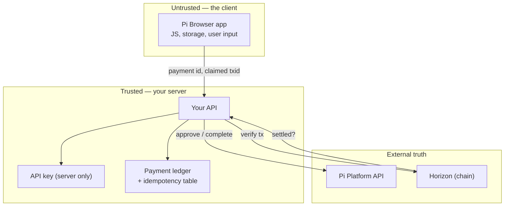

# RES-006 · Security Standards for Pi Applications

> **Claim types:** `FACT` — official, dated, linked · `ANALYSIS` — this repository's reasoning, fallible ·
> `PROPOSAL` — a suggestion with no official status.
>
> **Scope warning:** this document describes *classes* of failure and *controls*. It contains no exploit for
> any live system. If you find a real vulnerability in a Pi app, report it privately to that app's owners —
> see [`CONTRIBUTING.md`](../CONTRIBUTING.md) §9.

---

## 1. Executive Summary

A Pi app has three assets worth attacking: **money** (Pi), **identity** (KYC-verified accounts), and **key
material** (developer API keys). Most incidents in ecosystems like this come from a small, boring set of
mistakes: value delivered before settlement, keys shipped to the client, retries without idempotency, and
trust in a client-supplied success flag.

Pi's own documentation already states the two rules that prevent most of this — deliver only after the
backend receives a successful completion (`S-03`), and the blockchain is the only source of truth for
exchanging Pi (`S-04`). `ANALYSIS` — Those two sentences are sufficient *policy*; what is missing is the
*implementation norm* that makes them hard to violate by accident.

This document turns the policy into a checklist: a numbered set of controls, a threat model, a verification
order, and an incident runbook. It is written to be usable in a code review, not admired in a repository.

---

## 2. Problem Statement

An app developer on Pi is asked to handle money on a platform where:

| Property of the environment | Security consequence |
|---|---|
| Auth and payments run inside a browser context (`S-02`) | The client is hostile territory; anything shipped there is readable |
| A platform API sits between the app and the chain (`S-06`) | Two sources of truth can disagree; which one wins must be decided deliberately |
| Payments are wrappers around chain transactions (`S-07`) | A "payment" is a multi-step state machine, and state machines have races |
| Node/SoloHost apps are user-installed, permissionless, in beta (`S-31`) | Supply-chain risk moves to end users' machines |
| Accounts are KYC-verified | A breach is an identity incident, not just a financial one |
| 60M+ potential users (`S-11`) | A single vulnerable app has an enormous blast radius |

`ANALYSIS` — None of this is unique to Pi. What is specific is the **combination**: browser-hosted payments,
a mediating platform API, a chain that is the real settlement layer, and a permissionless app runtime on user
hardware. A generic web-security checklist does not cover the seams between those four.

---

## 3. Current State

### 3.1 What official documentation already establishes

| Rule | Official wording | Source |
|---|---|---|
| Deliver after completion | "Deliver purchased features **only after** the backend receives a successful `/complete` response from Pi." | `S-03` |
| Chain is settlement | "The Pi blockchain is obviously the only source of truth for exchanging Pi." | `S-04` |
| Browser-scoped trust | "Pi SDK authentication and payment features require the application to run inside the Pi Browser (or the Sandbox)." | `S-02` |
| Pre-signed transactions | "Transactions must be pre-signed; the SDK does not build or sign transactions for you." | `S-02` |
| Three-phase payment | Create → approve; user transacts; complete | `S-07` |
| Third-party packages are at user risk | SoloHost "uses an open, permissionless publisher flow. Users should assess individual packages and install them at their own risk." | `S-31` |

### 3.2 What is not published

| Missing | Consequence |
|---|---|
| A security checklist for app developers | Every team invents one; most omit something |
| A documented error taxonomy for payment states | Retry logic is guessed |
| Guidance on key rotation | Keys are long-lived by default |
| A reference implementation with tests | The correct order is described but not runnable |
| Any published incident-reporting channel for apps | Disclosures have no destination |
| Criteria for "verified app" in the directory | Users cannot infer safety from a badge (`OQ-004`) |

> The absence of a published checklist is not an accusation. It is an opportunity: a checklist is one of the
> few security artefacts that improves outcomes without requiring anyone's permission.

---

## 4. Proposed Solution

`PROPOSAL` — Fifteen mandatory controls, five recommended ones, and a runbook. "Mandatory" here means
*mandatory under this standard*, not mandatory under Pi's terms.

### 4.1 The five invariants

Every control below exists to protect one of these:

| # | Invariant | If broken |
|---|---|---|
| I1 | **Value is delivered only after settlement is verified independently** | Free goods; double delivery |
| I2 | **Secrets never reach the client** | Full compromise of the app's payments |
| I3 | **Every state-changing operation is idempotent** | Double charges; duplicate grants |
| I4 | **The chain, not the client, decides what happened** | Fraud via a forged callback |
| I5 | **Personal data is minimised and never used as an authorisation token** | Identity breach; account takeover |

### 4.2 Mandatory controls

| # | Control | Protects | Verification |
|---|---|---|---|
| M1 | Server-side approval before the user signs | I4 | Code review: approval path exists before UI confirm |
| M2 | Verify the `txid` on Horizon: destination, amount ≥ price, native asset, memo/payment id, validated ledger | I1, I4 | Integration test with a wrong-destination fixture |
| M3 | Deliver only after `/complete` succeeds **and** M2 passes | I1 | Test that reordered calls fail closed |
| M4 | Idempotency key on every write; unique constraint on `payment_id` | I3 | Replay the same request twice; assert one effect |
| M5 | Never trust client-supplied `amount`, `status`, or `txid` for authorisation | I4 | Fuzz the client payload |
| M6 | API keys stored server-side only; never in HTML, JS bundles, source maps, or mobile binaries | I2 | `grep` the built bundle for the key |
| M7 | Keys scoped per environment; sandbox keys never valid on Mainnet | I2 | Attempt a sandbox key against Mainnet in a test |
| M8 | Secrets from environment/secret manager, not from a committed file | I2 | `.gitignore` + history scan |
| M9 | Rotate keys on a schedule **and** on any suspected exposure | I2 | Documented rotation runbook with a date |
| M10 | Verify the destination address server-side; never accept it from the client | I1 | Test with a client-substituted address |
| M11 | Bound retries: max 3, exponential backoff with jitter; never retry a permanent 4xx | I3 | Chaos test with injected 500/429 |
| M12 | Time-bound sessions; re-authenticate for high-value actions | I5 | Session replay test |
| M13 | Store the minimum KYC-derived data; never log it; encrypt at rest | I5 | Log audit for PII patterns |
| M14 | Validate and pin third-party dependencies; review SoloHost/npm packages before use | I2 | Lockfile + advisory scan in CI |
| M15 | A written incident runbook with a named contact and a disclosure path | I1–I5 | Dry run once per year |

### 4.3 Recommended controls

| # | Control | Why |
|---|---|---|
| R1 | Display allowance amount, spender, and expiry at signing (contracts) | Informed consent for `approve` |
| R2 | Publish an app manifest declaring permissions | Makes review possible ([`PR-002`](../proposals/proposal-002-developer-standards.md)) |
| R3 | Log a ledger reference for every delivered purchase | Dispute resolution |
| R4 | Rate-limit per user and per IP on your own endpoints | Abuse, not just upstream limits |
| R5 | Independent review before handling real value | Cheapest possible audit |

---

## 5. Architecture

### 5.1 Trust boundary

`ANALYSIS` — The single most important line in that diagram is `UI → API`: everything arriving across it is a
*claim*, not a fact. A codebase that treats any field from that arrow as authoritative has I4 broken, and I1
will follow.

### 5.2 Correct verification order

| Step | Action | Fail-closed behaviour |
|---|---|---|
| 1 | Client requests a purchase | Create a pending record keyed by idempotency key |
| 2 | Server approves the payment | If approval fails, do not show a signing prompt |
| 3 | Client signs and submits the transaction | Nothing granted yet |
| 4 | Client reports completion | Treat as a **hint**, not proof |
| 5 | Server fetches the payment from the platform API | Mismatch → reject |
| 6 | Server verifies the `txid` on Horizon (destination, amount, asset, memo, validated ledger) | Any mismatch → reject, alert |
| 7 | Server calls `/complete` | Failure → do not deliver |
| 8 | Server grants entitlement, keyed by `payment_id`, exactly once | Duplicate → return prior result |

`ANALYSIS` — Steps 5–7 are where implementations diverge. The most common defect is performing step 8 before
step 6, which is indistinguishable from "give away the product" once an attacker learns the shape of the
callback.

### 5.3 Failure modes and required behaviour

| Failure | Naive response | Correct response |
|---|---|---|
| Timeout on `/complete` | Retry immediately | Retry with idempotency key; re-check state first |
| `429` from platform | Retry in a tight loop | Backoff with jitter; surface a queued state |
| Horizon unreachable | Deliver, "verify later" | Block delivery; queue verification; never deliver unverified |
| Duplicate completion callback | Grant again | Return the prior result (idempotent) |
| Amount mismatch | Deliver anyway | Reject and alert — this is a signal, not a rounding error |
| `txid` reused from another payment | Not checked | Reject; `txid` must be unique across payments |

### 5.4 Supply chain, including SoloHost

| Surface | Risk | Control |
|---|---|---|
| npm dependencies | Typosquat, compromised maintainer | Lockfile, advisory scan, minimal dependency policy |
| PiOS-licensed community code | Varies by author | Treat as third-party; review before use (`S-13`) |
| SoloHost apps | Run on users' machines; permissionless publishers (`S-31`) | Declare permissions; users assess packages (official guidance) |
| AI-generated code (App Studio) | Plausible-looking but unverified logic | Review payment paths line by line; never ship unreviewed payment code |
| Contract calls | Allowance drain, upgrade surprises | Registry + hash verification ([`RES-011`](smart-contract-ecosystem.md)) |

`ANALYSIS` — App Studio deserves a specific warning. Generative tooling is excellent at producing a *working*
payment flow and has no notion of a *safe* one. The code will run, the demo will succeed, and the ordering bug
in §5.2 will be invisible until someone exploits it. Generated payment code must be treated as an unreviewed
draft.

---

## 6. Benefits and Risks

### 6.1 Benefits

| Benefit | Who |
|---|---|
| Fewer free-goods and double-delivery incidents | App owners |
| Consistent review criteria | Reviewers |
| A defensible answer after an incident | Everyone |
| Lower key-leak blast radius | Users |
| A checklist that fits in a PR template | Teams without a security hire |

### 6.2 Risks of *this document*

| Risk | Severity | Mitigation |
|---|---|---|
| **Checklist complacency** — "we passed 15/15, we are secure" | High | Controls reduce known classes; they do not prove absence of unknown ones |
| **Staleness** as the API changes | High | Dated `FACT`s; 60-day review cycle |
| **Wrong specifics** in examples (endpoints, fields) | High | Examples cite `S-06`/`S-07`; treat field names as illustrative and verify against docs |
| **Over-broad advice** for non-payment apps | Medium | Scope stated per control |
| **Encouraging home-grown crypto** | Medium | Explicit non-goal: never roll your own key management, use platform primitives |

### 6.3 Explicit non-goals

- This is not a penetration-testing guide.
- It does not evaluate the security of Pi's platform itself.
- It does not cover smart-contract auditing methodology (see [`RES-011`](smart-contract-ecosystem.md)).
- It is not legal or regulatory advice, including on KYC data retention.

---

## 7. Implementation Roadmap

| Phase | Work | Effort | Exit criterion |
|---|---|---|---|
| 1 | Add the 20 controls to a PR template | 1 hour | A PR cannot merge without ticking them |
| 2 | Build the test fixtures in §5.3 (wrong destination, replayed txid, duplicate callback) | 1 day | Each fixture fails an unsafe implementation |
| 3 | Write the reference implementation with tests | 2 days | Two independent teams pass the fixtures |
| 4 | Publish the error taxonomy ([`RES-005`](developer-tools.md) §4) | 1 day | Retry decisions are documented per code |
| 5 | Incident runbook + disclosure address | 1 day | A dry run produces a timeline |
| 6 | Annual review against the current docs | recurring | `last_reviewed` never older than 90 days |

---

## 8. Open Questions

1. Is there an official security contact or disclosure programme for Pi apps? (`OQ-015`)
2. What exactly does a "verified app" badge in the directory attest to? (`OQ-004`)
3. Are platform API keys scoped by permission (e.g. read-only vs payments)? (`OQ-016`)
4. Is there a documented key-rotation procedure, and does rotation invalidate in-flight payments?
5. Does the Platform API emit webhooks, or must completion be polled? (`OQ-014`)
6. What are the retention obligations for KYC-derived data in the relevant jurisdictions?
7. Are SoloHost app permissions declared in a machine-readable form yet?
8. Does the platform provide any replay protection beyond the app's own idempotency keys?

See [`RES-012`](open-questions.md).

---

## 9. References

| # | Source | Type | Date |
|---|---|---|---|
| `S-02` | Pi Browser requirement; pre-signed transactions | Official | retrieved 2026-10-25 |
| `S-03` | Deliver only after `/complete` | Official | retrieved 2026-10-25 |
| `S-04` | Blockchain as the only source of truth | Official | retrieved 2026-10-25 |
| `S-06` | `PaymentDTO` fields and statuses | Official | pinned 2024-08-28 |
| `S-07` | Payments as wrappers around chain transactions | Official | retrieved 2026-10-25 |
| `S-08` | Server-side signing | Official | pinned 2023-01-27 |
| `S-13` | PiOS licence (third-party code scope) | Official | retrieved 2026-10-25 |
| `S-29` | Pi Node 0.6.2 (SoloHost app states) | Official | 2026-08-14 |
| `S-31` | SoloHost beta; permissionless publishers; user risk | Official | 2026-08-27 |
| `S-55` | `TokenClient` allowance semantics | Official (code) | pinned 2026-04-17 |
| `PR-002` | Developer standards proposal | Proposal | 2026-10-25 |

---

**Related:** [`RES-005`](developer-tools.md) · [`RES-011`](smart-contract-ecosystem.md) ·
[`PR-002`](../proposals/proposal-002-developer-standards.md) · [`DISCLAIMER.md`](../DISCLAIMER.md)
