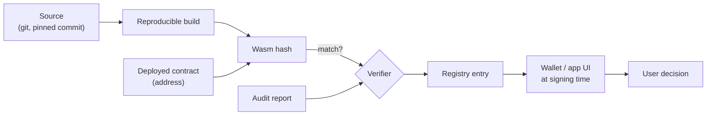

# RES-011 · The Smart-Contract Ecosystem

> **Claim types:** `FACT` — official, dated, linked · `ANALYSIS` — this repository's reasoning, fallible ·
> `PROPOSAL` — a suggestion with no official status.

---

## 1. Executive Summary

Pi's smart-contract layer is **Soroban**: the Stellar contract platform. The evidence is concrete — the
official reference contract declares `soroban-sdk = "22.0.0"` and uses `soroban_sdk::token::TokenClient`
(`S-55`). The first capability, subscriptions, was released on **Testnet** on 2026-04-17 and was described as
under external audit, with Mainnet rollout pending (`S-26`).

So the situation in late 2026 is: **a contract platform exists, one reference contract exists, and an
ecosystem does not yet exist.**

`ANALYSIS` — The gap between "contracts are possible" and "contracts are trustworthy to use" is filled by four
artefacts that are cheap to build and currently absent: a **contract registry**, a **source-verification
path**, **standard interfaces**, and **audit norms**. Without them, every contract is a bespoke trust decision
made by a user who cannot read Rust.

This document does not propose new contract features. It proposes the **metadata layer** that makes contracts
usable by people who are not their authors.

---

## 2. Problem Statement

Consider a user who is told "this app uses a Pi smart contract for subscriptions". They can reasonably ask:

| Question | Answerable today? |
|---|---|
| Is the contract address the one the app's developers wrote? | Only by trusting the app |
| Is the deployed bytecode the compiled output of the published source? | No public path |
| Has it been audited, by whom, with what scope, and what was found? | `S-26` says an audit is happening; no public report found |
| Can it be upgraded? By whom? | Not discoverable from the address |
| What can it do to my funds — transfer, approve, hold, or only read? | Requires reading Rust |
| If it holds my allowance, what is the worst case? | Requires understanding Soroban allowances |

`ANALYSIS` — Every one of these is a *metadata* question, not a *protocol* question. Soroban does not need to
change to answer any of them. Someone needs to publish, and keep publishing, the answers.

There is a second problem, specific to allowances. The subscription design relies on `approve` +
`transfer_from` (`S-54`, `S-55`). That is the correct primitive, and it is also the sharpest edge a user can
be handed: an approved spender can draw down up to the allowance until expiry. Most users will not understand
that sentence unless an interface explains it at signing time.

---

## 3. Current State

### 3.1 What exists

| Element | Detail | Source | Status |
|---|---|---|---|
| Contract platform | Soroban (Stellar contract platform) | `S-55` | Live capability |
| SDK version in reference contract | `soroban-sdk = "22.0.0"` | `S-55` | Fact |
| First capability | Subscription support | `S-26` | **Testnet** |
| Audit | "being reviewed by external auditing services" | `S-26` | In progress, no public report found |
| Mainnet rollout | Pending at publication | `S-26` | Pending |
| Specification | `PiRC2` — Subscription Contract API | `S-54` | **RFC**, commit `dc86dfd` |
| Reference implementation | `PiNetwork/SmartContracts` | `S-55` | Public |
| Token interaction | `TokenClient`: `approve`, `transfer`, `transfer_from`, `allowance`, `balance` — scalar `i128` | `S-55` | Fact |
| Stored state | `Service`, `Subscription`, `ProcessResult`, event `charge` | `S-55` | Fact |
| Launchpad contract design | `PiRC1` — launch mechanics, liquidity pool, PiPower | `S-53` | **RFC** |
| Protocol 28 | Reported to add zero-knowledge / privacy-preserving contract capability | `M-01` + sibling repo | **Unconfirmed wording** — see note |

> **Note on protocol 28.** A sibling repository records that a protocol upgrade "added zero-knowledge /
> privacy-preserving smart-contract capability" and observed `protocol_version = 28` on 2026-10-18. This
> repository records that as a *report*, not as a verified feature list: the primary source for the exact
> capability set has not been pinned here. Any document relying on it must say so. See `SOURCES.md` §4.

### 3.2 What is missing

| Missing | Consequence | Difficulty |
|---|---|---|
| Contract registry (address → source → audit → status) | Every user must independently trust every app | Low |
| Source-verification path (reproducible build) | "Open source" is a claim, not a check | Medium |
| Standard interfaces beyond the token interface | Every integration is bespoke | Medium |
| Upgrade / admin disclosure | Users cannot see who can change behaviour | Low |
| Testnet → Mainnet promotion checklist | Testnet success does not imply Mainnet safety | Low |
| Contract-focused developer tooling (TS client generation, local harness) | High barrier for app developers | Medium |
| Formal-verification or property-testing norms | Subtle bugs survive review | High |
| Fee and resource model documentation for contract calls | Costs are unpredictable | Low–Medium |

`ANALYSIS` — The ordering above is deliberate: the cheapest items (registry, upgrade disclosure, promotion
checklist) unlock the most trust per hour of work. Formal verification is valuable and should not be first,
because it produces nothing anyone can browse.

---

## 4. Proposed Solution

`PROPOSAL` — A metadata layer with four components, each independently adoptable.

### 4.1 The four components

| # | Component | Minimum viable form | Who |
|---|---|---|---|
| 1 | **Contract registry entry** | JSON: address, network, name, source URL, commit, build instructions, audit links, admin/upgrade key holders, capabilities | Contract author |
| 2 | **Verification badge** | A third party rebuilds from source and compares the deployed Wasm hash | Any verifier |
| 3 | **Interface declarations** | For each contract: which token methods it can call, and the worst-case effect on a user's allowance | Contract author |
| 4 | **Promotion checklist** | Testnet → Mainnet gate with named checks (audit resolved, registry complete, upgrade policy disclosed, incident contact) | Author + reviewer |

### 4.2 Registry entry schema (illustrative)

```json
{
  "schema": "pi-contract-registry/1",
  "network": "mainnet",
  "address": "C...",
  "name": "subscriptions",
  "source": { "url": "https://github.com/...", "commit": "d5b3915", "path": "contracts/subscription" },
  "build": { "toolchain": "soroban-sdk 22.0.0", "reproducible": true, "wasm_sha256": "..." },
  "audits": [{ "auditor": "...", "date": "YYYY-MM-DD", "report_url": "...", "scope": "..." }],
  "admin": { "upgradeable": false, "key_holders": [], "policy": "immutable" },
  "user_impact": {
    "can_transfer_user_tokens": true,
    "requires_allowance": true,
    "max_allowance_recommended": "explicit at signing"
  },
  "status": "verified | partial | unverified | contradicted"
}
```

### 4.3 The one rule that matters

> **A contract that cannot be matched to source and to an audit must be displayed as unverified — always, and
> without embarrassment.**

`ANALYSIS` — An honest "unverified" label is more useful than a dishonest "audited" one, because it tells the
user which risk they are taking. It also creates the demand that makes verification worth doing.

---

## 5. Architecture

### 5.1 Trust path from source to user



`ANALYSIS` — The critical link is the **Wasm hash comparison**. Everything else is documentation; that single
comparison is what turns a claim into a check. If reproducible builds are not achievable, say so and display
`unverified` — a registry that cannot distinguish these cases is worse than none.

### 5.2 Where the registry belongs in a transaction flow

| Moment | What the user should see | Where it comes from |
|---|---|---|
| Before connecting | Contract name, verified status, audit date | Registry |
| At `approve` | Exact allowance, spender, expiry | Contract call parameters + registry `user_impact` |
| At `transfer_from` | Who is drawing, how much, for what service | Service metadata in the contract (`S-55` has `Service`) |
| After | Ledger reference for the charge | Chain |

`ANALYSIS` — The `Service` struct already contains `name` and `price` (`S-55`). That means a wallet *could*
display "Subscribing to <name> for <price> per <period>" instead of a raw allowance number. This is a small
UI change with an outsized effect on informed consent.

### 5.3 Inherited constraints worth stating

| Constraint | Consequence |
|---|---|
| Soroban state has archival / time-to-live semantics | Long-lived subscription state needs a plan for restoration; not a Pi-specific issue but must be documented per contract |
| Token amounts are `i128` scalars | No per-unit metadata; see [`SOURCES.md`](../SOURCES.md) §1.3 note on the token interface |
| Contracts can only act on what they are given | A contract cannot observe anything the ledger does not record |
| Upgradeability is a design choice per contract | Must be disclosed, because it changes the trust model entirely |

---

## 6. Benefits and Risks

### 6.1 Benefits

| Benefit | For whom | Observable effect |
|---|---|---|
| Trust becomes checkable | Users | A verified badge that links to a hash |
| Safer defaults for developers | Builders | A checklist instead of folklore |
| Audits become comparable in scope | Buyers of audits | Scope fields, not PDFs alone |
| Incident response is possible | Everyone | A named contact per contract |
| Reuse increases | Builders | Standard interfaces mean composable parts |

### 6.2 Risks

| Risk | Severity | Mitigation |
|---|---|---|
| **Registry capture** — one group decides what is "verified" | High | Publish inputs; allow multiple verifiers; no exclusive badge |
| **Verification implies safety** | High | Label describes *claims*, not quality; explicit copy |
| **Upgradeable contracts invalidating verification** | High | Bind verification to a Wasm hash and show it as `stale` on change |
| **Testnet-to-Mainnet behaviour drift** | Medium | Promotion checklist + post-deploy smoke tests |
| **Allowance confusion causing loss** | High | UI must show amount, spender, expiry at signing; recommend minimal allowances |
| **Regulatory characterisation of launched tokens** | Medium | Out of scope here; see [`RES-003`](launchpad-opportunities.md) §6.2 |
| **Over-engineering before adoption** | Medium | Build the registry before the toolchain |

---

## 7. Implementation Roadmap

| Phase | Deliverable | Prerequisite | Exit criterion |
|---|---|---|---|
| 0 | Registry schema + one entry for the official reference contract | `S-55` | A human can read one entry and answer §2's questions |
| 1 | Wasm-hash verification procedure documented and run once | Reproducible build | Hash match or a documented reason it cannot match |
| 2 | Interface declarations for the subscription contract | Phase 1 | Worst-case allowance effect stated in one paragraph |
| 3 | Promotion checklist published | Phase 2 | A second contract uses it |
| 4 | A UI (wallet or app) displays registry status at signing | Phase 3 | Screenshot of an `unverified` warning in a real flow |
| 5 | Multi-verifier model | Phase 4 | Two independent verifiers for one contract |

`ANALYSIS` — Phase 1 is the gate. If the official reference contract cannot be reproducibly rebuilt, that is
itself an important finding, and the registry should say so plainly rather than inventing a workaround.

---

## 8. Open Questions

1. Has the subscription contract's external audit produced a public report? (`OQ-011`)
2. Is the deployed bytecode reproducible from the published source with the stated toolchain?
3. Is the contract upgradeable? If so, who holds the key, and is that stated anywhere?
4. What is the fee/resource model for contract invocation on Pi, and where is it documented?
5. Does protocol 28 actually add the capabilities reported, and where is the primary source?
6. Are there plans for a standard interface registry, or is `PiRC` the intended venue?
7. How does contract state archival/TTL behave on Pi specifically?
8. Will Launchpad contracts (`S-53`) be verified under the same regime?

See [`RES-012`](open-questions.md).

---

## 9. References

| # | Source | Type | Date |
|---|---|---|---|
| `S-26` | First smart contract: subscriptions | Official | 2026-04-17 |
| `S-52` | PiRC process | Official (RFC) | retrieved 2026-10-25 |
| `S-53` | PiRC1 — Ecosystem Token Design | Official (RFC) | pinned 2026-02-20 |
| `S-54` | PiRC2 — Subscription Contract API | Official (RFC) | pinned 2026-04-17 |
| `S-55` | Reference contracts (`soroban-sdk 22.0.0`) | Official (code) | pinned 2026-04-17 |
| `M-01` | `protocol_version = 28` | Measurement | 2026-10-18 |
| `S-70` | Reported Protocol 28 completion | **Secondary** | 2026-10-23 |

---

**Related:** [`RES-003`](launchpad-opportunities.md) · [`RES-006`](security-and-trust.md) ·
[`RES-005`](developer-tools.md) · [`SOURCES.md`](../SOURCES.md) §5
