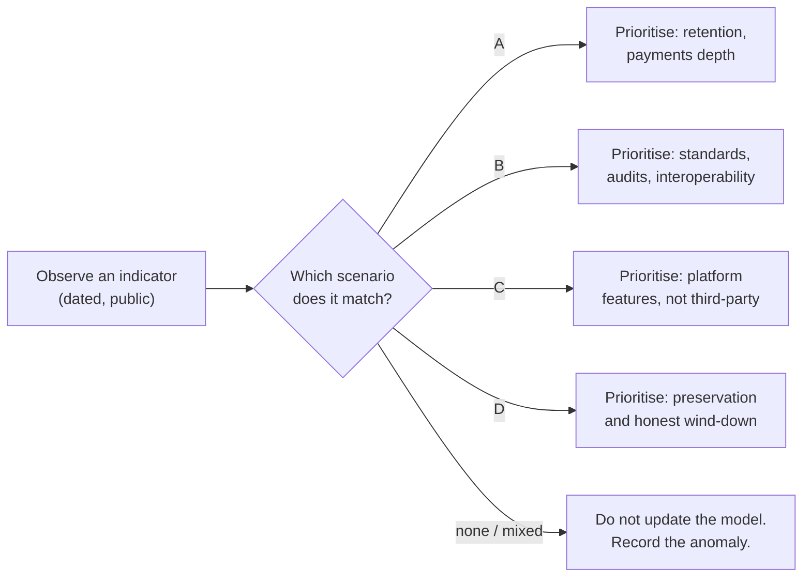

# RES-010 · Ten-Year Scenarios

> **Claim types:** `FACT` — official, dated, linked · `ANALYSIS` — this repository's reasoning, fallible ·
> `PROPOSAL` — a suggestion with no official status.

---

## 0. Read this before the scenarios

**This document contains no predictions.** It contains **scenarios**: internally consistent descriptions of
how the ecosystem could plausibly develop, each paired with **observable indicators** that would tell you which
one is happening.

Three deliberate refusals:

| Refused | Why |
|---|---|
| Probabilities ("60% chance of Scenario B") | No base rate exists; a number would be invented precision |
| Dates for outcomes ("by 2031, Pi will…") | Nobody can know; the harm of being wrong is asymmetric |
| Price implications | Out of scope permanently ([`DISCLAIMER.md`](../DISCLAIMER.md)) |

A scenario is useful if it changes a decision you make **now**. If reading one does not change anything you
would do, it is entertainment — and this repository does not publish entertainment.

---

## 1. Executive Summary

Two variables dominate the next decade, and neither is technical throughput:

1. **Developer depth** — do independent builders ship apps that people pay for, repeatedly?
2. **Openness** — do institutions, regulators, and external platforms integrate, or does the ecosystem remain
   self-contained?

`ANALYSIS` — Those two axes produce four scenarios. The technical roadmap is roughly the same in all four; what
differs is **who does the work** and **whether outside capital and users can enter**.

The strategic consequence is uncomfortable but useful: only a small set of actions is valuable in *every*
scenario. Those are the only actions worth arguing about today. This document ends with them.

---

## 2. Problem Statement

Ecosystem discussions usually collapse into one of two unhelpful modes:

| Mode | Shape | Failure |
|---|---|---|
| **Extrapolation** | "Adoption is growing, therefore it will continue" | Ignores regime change; cannot be wrong |
| **Binary prophecy** | "Pi will succeed" / "Pi will fail" | Unfalsifiable; produces tribes, not analysis |

Neither helps a builder decide what to do on Monday.

`ANALYSIS` — Scenarios are the alternative because they are **conditional and observable**. Instead of asking
"will Pi succeed?", a scenario asks: "if developers ship paid apps but regulators block integration, what does
my work look like, and how would I notice we are in that world?"

---

## 3. Current State

The starting conditions, as of the evidence cut-off. These are the `FACT`s the scenarios branch from.

| Condition | Value | Source | Direction of uncertainty |
|---|---|---|---|
| Users | "60+ million" Pioneers (official claim) | `S-11` | Whether they transact, not just mine |
| Identity | KYC-verified base, described as compliant | `S-11` | Depth of verification unknown |
| Nodes | "420,000+" runners (official claim) | `S-31` | Utilisation beyond chain support is new |
| Payments | Live platform payments; chain is settlement | `S-06`, `S-04` | Merchant adoption unmeasured |
| Contracts | Soroban, first capability on Testnet | `S-26` | Mainnet timing and audit outcome |
| Tokens | Ecosystem-token design published; Launchpad on Testnet | `S-23`, `S-24` | Launchpad Mainnet design may change |
| Tooling | Docs consolidated; App Studio; SoloHost beta | `S-01`, `S-30`, `S-31` | Whether tools reduce failure rates |
| Compute | 5-node PoC | `S-29` | Verification and economics unspecified |
| External access | CEX/onramp integrations since Open Network | `S-20` | Regulatory variation by jurisdiction |
| Open source (core) | Not established | `SOURCES.md` §5 | Affects auditability and fork risk |

---

## 4. Proposed Solution

### 4.1 The two axes

| Axis | Low | High |
|---|---|---|
| **Developer depth** | Few independent builders; platform features ship, third-party products do not | Many builders ship apps with recurring paid usage |
| **Openness** | Self-contained: limited external integration, cautious institutional posture | Integrated: businesses, external platforms, and capital participate |

### 4.2 The four scenarios

#### Scenario A — *Quiet Utility*

*High developer depth · low openness.*

Many small, useful apps inside the Pi Browser; payments in Pi; a real merchant long tail; little external
capital. Success is measured in daily transactions per user, not in announcements.

| Aspect | Description |
|---|---|
| Who builds | Individual developers and small teams, mostly from the existing community |
| What works | Payments, subscriptions, local commerce, games with real utility |
| What struggles | Cross-border business onboarding, large-scale capital formation |
| Failure mode | Ceiling on app quality: small teams, thin tooling, no external competition to raise the bar |
| Early signal | App Studio apps start retaining users; subscription contract usage grows after Mainnet |

#### Scenario B — *Platform Economy*

*High developer depth · high openness.*

Pi becomes a platform that outside businesses integrate with: KYB-verified merchants, external tooling,
institutional partners, possibly regulated token products. Developer depth and openness reinforce each other.

| Aspect | Description |
|---|---|
| Who builds | Professional teams, some venture-funded, alongside community developers |
| What works | Payments at scale, tokenised products, compute services, developer tooling as a market |
| What struggles | Governance: who sets standards when money is involved |
| Failure mode | Standards imposed by the largest players; community voice becomes advisory only |
| Early signal | Third-party tools with paying customers; external audits published; multiple independent indexers |

#### Scenario C — *Walled Garden*

*Low developer depth · low openness.*

The platform ships features; third-party apps remain mostly thin. Most usage is the mining app plus a handful
of first-party experiences. The ecosystem is large in users and small in surface area.

| Aspect | Description |
|---|---|
| Who builds | The platform, plus a long tail of low-quality apps |
| What works | Consumer features, onboarding, identity |
| What struggles | Anything requiring a third-party business model |
| Failure mode | Users treat Pi as a wallet, not a platform; developer tooling atrophies |
| Early signal | App Studio volume without retention; directory rankings dominated by a few apps |

#### Scenario D — *Attrition*

*Low developer depth · low openness.*

Activity declines: fewer new builders, fewer transactions per user, tools maintained but unused. Not a collapse
— a slow drift to irrelevance for builders.

| Aspect | Description |
|---|---|
| Who builds | Almost nobody new |
| What works | Existing balances, occasional transfers |
| What struggles | Everything requiring momentum: tooling, standards, audits |
| Failure mode | Research like this document becomes archaeology |
| Early signal | Consecutive quarters with no new `stable` third-party tooling; declining app submissions |

### 4.3 Wildcards (not a fifth quadrant)

| Wildcard | What it would do | Why it is not a scenario |
|---|---|---|
| **Compute pivot** | Node compute becomes the ecosystem's primary product, dwarfing app payments | It overlays A–D rather than replacing them |
| **Regulatory shock** | A major jurisdiction restricts access or token activity | A driver, not an end state |
| **Core open-sourcing** | Consensus/node code published, enabling independent verification and forks | Changes trust assumptions across all scenarios |
| **Major external integration** | A large platform adopts Pi payments natively | Compresses years of openness into months |

---

## 5. Architecture (of the analysis, not the network)

### 5.1 How to use a scenario

### 5.2 Leading indicators

Each is observable, and each has a threshold. Thresholds are `ANALYSIS` — they are guesses made explicit so
that they can be argued with.

| # | Indicator | Where to observe | Points toward | Threshold |
|---|---|---|---|---|
| I1 | Independent apps with recurring paid usage | Public app pages, transaction counts | A / B | 20+ apps with non-trivial repeat payments |
| I2 | Third-party developer tools with paying users | Repos, package downloads, changelogs | B | 3+ maintained tools not funded by the platform |
| I3 | Contract Mainnet usage | Chain | A / B | 100+ distinct contracts invoking in a month |
| I4 | Audit reports published | Vendor sites, registries | B | 3+ public reports for Pi contracts |
| I5 | External merchant onboarding (KYB) | `S-37` | B | Growth in verified businesses outside the existing community |
| I6 | App Studio retention | Directory, app telemetry (if published) | C | High creation, low 90-day retention |
| I7 | Node compute beyond PoC | Official blog, job counts | wildcard | Any paid, verified job at scale |
| I8 | Regulatory actions by jurisdiction | Regulators, official statements | C / D | A major market restricting |

### 5.3 What would falsify each scenario

| Scenario | Falsified by |
|---|---|
| A | External capital entering at scale while developer count stays flat (that is B, not A) |
| B | Developer numbers rising with no external integration and no capital (that is A) |
| C | Sustained growth in independent paid apps (that is A) |
| D | Any two of I1–I4 improving for four consecutive quarters |

---

## 6. Benefits and Risks

### 6.1 Benefits of scenario thinking

| Benefit | Mechanism |
|---|---|
| Decisions become robust | You choose actions that survive multiple futures |
| Early detection | Indicators give warning before the narrative changes |
| Better disagreement | People argue about indicators, not identities |
| Less over-promising | Scenarios make uncertainty explicit |

### 6.2 Risks of this document

| Risk | Severity | Mitigation |
|---|---|---|
| **Scenarios read as forecasts** | High | §0; no probabilities; indicators, not dates |
| **Anchoring** on the named four | Medium | Wildcards section; invite a fifth |
| **Indicator cherry-picking** to support a prior | High | Publish thresholds before observing; record anomalies |
| **False precision** in thresholds | Medium | Label them `ANALYSIS`; revise openly with dates |
| **Ignoring a discontinuity** | High | Wildcards; explicit "record the anomaly" path |

### 6.3 No-regret actions

`PROPOSAL` — The only strategic conclusion this document will state: these actions pay off in **all four**
scenarios, which is why they are worth doing regardless of which one unfolds.

| Action | Why it survives every scenario |
|---|---|
| Payment-verification and security norms ([`RES-006`](security-and-trust.md)) | Needed wherever money moves |
| RPC measurement ([`PR-001`](../proposals/proposal-001-rpc-monitoring.md)) | Needed by every client in every future |
| Launch/app disclosure ([`PR-004`](../proposals/proposal-004-launchpad-transparency.md)) | Reduces harm whether launches succeed or fail |
| Contract registry ([`RES-011`](smart-contract-ecosystem.md)) | Valuable even if only one contract ever ships |
| Documentation with dates | The only artefact that helps a reader in 2031 judge 2026 |

---

## 7. Implementation Roadmap

For a scenario document, "implementation" means **keeping it honest**.

| Phase | Work | Cadence |
|---|---|---|
| 0 | Publish scenarios + indicators | 2026-10-25 |
| 1 | Collect a baseline for I1–I8 | 2026-11 |
| 2 | Quarterly indicator review, with a written note on anomalies | every 3 months |
| 3 | Annual re-write: retire scenarios that no longer fit | yearly |
| 4 | Archive each version with its date | yearly |

`ANALYSIS` — The quarterly review is the entire value. A scenario set that is written once and never revisited
becomes a horoscope with footnotes.

---

## 8. Open Questions

1. Which indicators can actually be measured without platform-internal telemetry? (`OQ-022`)
2. Is there any public data on app retention or transaction volume per app?
3. What counts as "external" integration for the openness axis?
4. Should a fifth scenario be added for "compute-first"?
5. How should a regulator-driven restriction be represented (driver vs scenario)?
6. Who maintains the indicator baseline, and how is funding kept from biasing it?

See [`RES-012`](open-questions.md).

---

## 9. References

| # | Source | Type | Date |
|---|---|---|---|
| `S-04` | Chain as settlement layer | Official | retrieved 2026-10-25 |
| `S-06` | Platform payments | Official | pinned 2024-08-28 |
| `S-11` | 60+ million Pioneers | Official | retrieved 2026-10-25 |
| `S-20` | Open Network; CEX/onramp integration | Official | 2025-02-20 |
| `S-23` | Ecosystem-token design for Mainnet | Official | 2026-02-20 |
| `S-24` | Launchpad / DEX on Testnet | Official | 2026-03-19 |
| `S-26` | Contracts on Testnet | Official | 2026-04-17 |
| `S-29` | Compute PoC (5 nodes) | Official | 2026-08-14 |
| `S-30` | App Studio pricing | Official | 2026-08-17 |
| `S-31` | 420,000+ Nodes; SoloHost beta | Official | 2026-08-27 |
| `S-37` | KYB list | Official | retrieved 2026-10-25 |

---

**Related:** [`VISION.md`](../VISION.md) · [`RES-001`](pi-network-future.md) ·
[`RES-012`](open-questions.md) · [`ROADMAP.md`](../ROADMAP.md)
